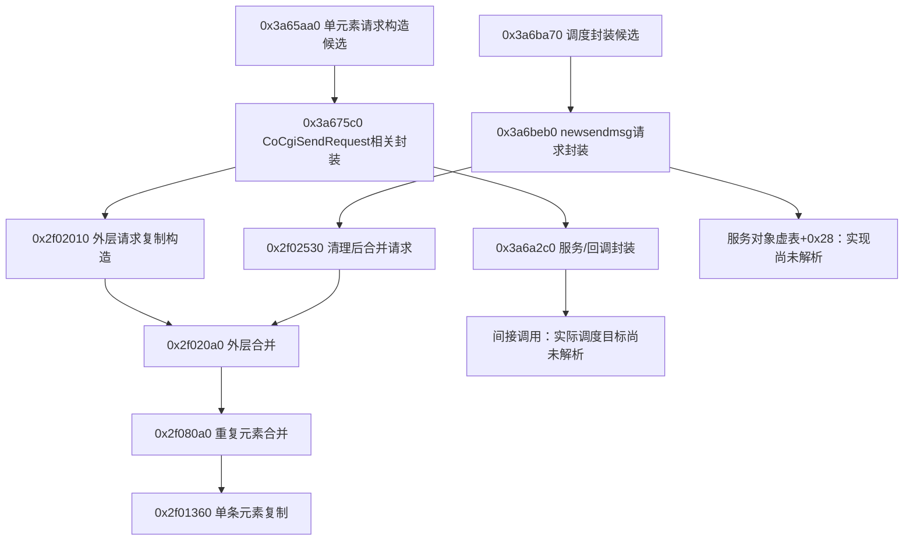

# Windows 微信 4.1.15.50：磁盘静态兼容性与发送调用图

## 最新：逐条结果、解析失败与回调注册（362–366）

2026-10-05继续。本阶段的目的仍是为**普通个人号真正最小化收发适配器**确定可检查的输入、调用和结果条件。这一轮补上了默认网络回调桥到任务处理方法的静态关系，并确认一个重要限制：**内层响应解析失败的布尔值会被外层覆盖，不能把回调完成或全零状态当作有效发送响应。** 尚未实现或启用适配器。

### 逐条响应与原消息怎样关联

[362](evidence/362-send-response-items.json)将表`0x9590278`的名称方法对应到`micromsg.MicroMsgResponseNew`，并核对元素复制、序列化和上层单消息消费路径。外层`SendMsgResponseNew`的声明条数位于`+0x28`，实际重复列表长度位于`+0x18`、元素指针数组位于`+0x10`。声明条数与实际长度是两个字段。

| 元素协议字段 | 对象偏移 | 本轮可确认的用途 |
| --- | --- | --- |
| 1 | `+0x10`，DWORD | 单消息消费方检查的逐条状态；零才进入本地成功状态更新分支，完整错误枚举未认证 |
| 2 | `+8`，嵌套对象 | 已确认布局，目标身份语义未认证 |
| 3–7 | `+0x14/+0x18/+0x1c/+0x20/+0x24`，DWORD | 已确认字段号、布局与存在位，业务名称未认证 |
| 8 | `+0x28`，QWORD | 成功分支复制到原消息对象`+0x148`；消息ID语义、唯一性及非零保证尚未认证 |

单消息调用方`0x3a65aa0`在发送等待返回后，要求整体两个DWORD状态均为零，再检查声明条数非零，随后取**第一条**响应检查字段1。该状态为零时，将原消息对象`+0x168`置为`2`，并复制字段8。非零逐条状态没有在这个分支改写整体状态对；后续还检查原消息状态，因此适配器必须保留这两个层次，不能只检查整体状态。

所查取首条和更新状态的区间没有核对实际列表长度、声明数与实际数相等、目标身份或请求字段。这里的关联来自同一任务封装和单消息调用栈，**不是已证明的通用批量匹配规则**；也不能据局部缺少检查断言所有上游都无验证。生成的必填字段检查要求元素字段1–7存在，不要求字段8；外层必填检查也没有比较声明条数与实际列表长度。

### 解析失败为何不能从完成状态判断

[363](evidence/363-send-response-parse-failure.json)核对以下控制流，仅属于磁盘静态观察，没有向微信发送或注入异常响应：

- 通用解析器`0x694800`先清空目标，调用具体解析器及必填检查，并结合完整缓冲标志返回布尔结果；因此确实有false路径。
- 发送封装解析方法`0x113d70`在`0x113da1`调用它，下一条有效指令`0x113da6`直接设置`AL=1`。正常返回时，内部解析结果被覆盖。
- 服务在`0x35e5da`调用封装解析方法后直接清理临时缓冲，没有检查返回的AL。外层响应包解析失败则进入诊断/清理路径；所查路径未新增“解析失败”状态，缺失或空的内层负载也会跳过解析。其后仍按当前状态值进入完成回调。
- 外层消息解析器在解析单个元素之前已经增加实际列表长度并存入元素指针；失败出口没有回滚这些写入。**对象存在或列表非空也不能证明解析完整。**

这不证明客户端在真实异常网络数据下必然误判，也不是漏洞利用复现；它说明当前所查回调API不足以提供独立可信的`parse_ok`。不能用默认对象、零值字段、promise状态或新增一个人工“verified”标志补齐证据。

### 默认网络回调注册链已补上

[364](evidence/364-send-callback-registration.json)核对构造和默认分支：服务构造`0x356200`创建捕获主服务指针的代理，保存在服务`+0x30`；调用公开诊断名为`mars::stn::SetCallback`的`0xdf4130`。setter将代理存入manager `+0x50`，默认桥保存在manager `+0x58`，桥的SetCallback再将代理存入桥`+8`。

```text
StnManager::OnTaskEnd (0xde9710)
  → 默认桥表 +0x48 → StnCallbackBridge::OnTaskEnd (0x2896460)
  → 代理表 +0x40 → 0x5ccf10
  → 捕获的主服务表 +8 → 任务完成处理 0x35dfe0
```

该链保留任务号参数，与358的任务映射查找对应。**成立范围是所查默认构造/注册分支。** 工厂另有“桥已存在”分支；运行时替换、初始化失败、对象生命周期、网络核心到OnTaskEnd的上游派发和执行线程尚未认证。这是对358–361注册缺口的推进，不是运行回调实测。

### 适配器约束与下一步

后续设计至少需分别保留：本地任务关联、解析有效性及字段存在性、声明/实际条数、逐条状态、原请求与目标对应、消息标识和独立送达证据。任何一层材料缺失，都不能把全零状态升级为“好友已收到”，结果未知时也不自动重发。本轮只形成设计约束，未添加这些运行行为。

下一项集中补**协程执行器、计时单位/默认值及对象生命周期**，把可确认条件与仍需观察的内容汇总成隔离观察方案；同时保留请求/响应身份匹配和接收消息ID、方向、新旧历史边界缺口。当前证据不足以开始注入或真实发送。

[366](evidence/366-send-response-items-validation.json)为同一执行者的固定哈希、指令、表、分支和文档静态复核；不属于产品、原生或竞态测试。[365](evidence/365-send-response-items-checkpoint.json)保存原监听仍停止，24569快照/24505最小化、unknown1，防待机请求不活动，最小化值仅最后观察。产品仍v0.1.22、自动回复关闭；未恢复窗口、重启监听、访问进程内存/密钥、加载微信DLL、安装框架、连接模型记忆或发送。

---

## 前一阶段：响应关联、promise完成与取消（358–361）

2026-10-05继续。当前仍在为**普通个人号真正最小化收发适配器**补本机调用条件；这一轮具体查“提交以后，程序怎样知道结果”。已把本地任务号、响应回调、等待完成和取消清理关联起来，尚未形成可运行适配器或送达验收。

### 本轮查明的结果路径

[358响应证据](evidence/358-send-response-promise-contract.json)记录13个解码区间、2个有锚点的叶函数、10条直接边、3张选定表及45条指令观察：

1. `0x3a6ba70`构造表为`0x96d8d38`的完成回调，捕获同一个promise状态；`0x3a6beb0`将它移动到请求封装的`+0x98`。
2. 提交实现`0x35bec0`把任务号作为本地映射的键，值保存请求封装指针。完成处理候选`0x35dfe0`按该键查找、取出封装、先移除映射节点，再解析响应并调用封装回调。提交服务子对象的`+0x58`与主对象的`+0x68`指向同一映射，需保留前轮确认的`+0x10`对象调整。
3. `0x35e655`调用回调表`+0x10`，对应`0x3a6c4d0 → 0x3a6c500`。回调通过封装表`+0x20`取得`+0xd8`响应成员，复制`SendMsgResponseNew`，构成一个包含两个DWORD状态值、响应字符串和共享响应对象的结果。
4. 结果`+0`取回调状态A；`+4`先取响应嵌套对象的状态，只有该状态为零且回调状态B非零时才用B替换。字段的完整枚举名称、所有错误码及逐条响应语义还没有认证。
5. `0x3a6c750 → 0x3b3880 → 0x3b3160`把结果存入promise的`+0xb8`，状态由pending `0`转为`1`。**这条路径不要求两个结果状态都为零，带错误的结果也可以正常完成promise。** 等待方`0x3a6b490`随后做类型检查并取回结果。

同一promise的`0x3b3160`在锁内只接受pending状态；已有状态时记录异常转换，不用新值覆盖。这是所查局部等待对象的保护，不能推导网络消息恰好投递一次。映射先移除，使之后通过同一路径查不到该键的回调无法再次调用该封装；仍不是跨账号、跨重启或全部竞态的去重证明。

**回调自身的true也不是发送成功。** `0x3a6c6ba`在正常返回时给出true；服务在`0x35e65e–0x35e674`用它决定是否析构请求封装。它在这里控制对象清理，不能作为业务成功值。

### 取消与超时推进到哪里

[359取消证据](evidence/359-send-cancel-timeout-contract.json)记录15个区间、2个叶函数、7条直接边、7张选定表及44条观察：

- 提交后另建表为`0x96d8e78`的停止回调，捕获发送服务与刚返回的任务号。`0x3b2c40`将其包装并注册到同一promise。
- pending promise的取消逻辑`0x3b2ec0`调用该hook；经`0x3b56e0 → 0x3a6ca50 → 0x3a6ca70`，用捕获的任务号调用服务表`+0x30 → 0x35d970`。后者进入磁盘初值指向的`StnManager::StopTask`路径，并查找、析构本地封装、移除任务映射。
- hook正常返回true后，取消逻辑请求promise状态`2`，仍受同一个pending守卫约束。这个true只说明hook正常返回；不能证明服务器没有接收或好友没有收到，更不代表撤回。
- `await_noexcept`有负值恢复分支，会调用上述promise取消逻辑；外层await对负值构造并抛出异常。
- scope注册的超时相关回调表`0x96d8f18`中，`+0x10 → 0x5c1c0`调用捕获job的cancel。job取消置标志并向执行器提交工作，其中一个回调以`-1`请求恢复协程。注册调用传入scope的`+0x48`字段，join之后还有以保存handle为参数的移除调用。

**尚未解析计时服务的完整实现、时长单位/默认值、实际触发与执行器到恢复点的全部连接。** 不能据此报告“超时已验证”，或保证取消一定先于网络发送。网络层到主服务完成方法的注册关系，以及响应解析的所有失败分支，也仍需补齐。

### 已可确定的适配器结果约束

| 观察到的信息 | 可以记录 | 不能据此报告 |
| --- | --- | --- |
| 本地任务号 | 本次本地请求的关联线索 | 提交成功、服务器消息ID、好友送达 |
| StartTask返回值 | 该层提交调用的返回 | 端到端发送成功 |
| promise状态1及结果对象 | 等待已完成，继续检查结果内容 | 没有错误或已送达 |
| 完成回调返回true | 所查服务允许清理封装 | 业务成功 |
| StopTask及本地取消完成 | 已请求停止并清理本地状态 | 已阻止发送、已撤回或未送达 |
| 超时/取消或缺少完整响应 | 保留最终结果未知，等待可关联证据 | 自动重发，或补造成功/失败结论 |

这是接入设计约束，当前没有实现或启用这些运行行为。下一项优先补**响应逐条结果与原请求的对应、网络完成回调注册和解析失败路径**，同时保留执行器/计时器及账号/目标身份缺口；只有证据足够后才形成隔离观察方案。旧版偏移不能直接调用，发送分析也不能替代接收方向、消息ID和新旧历史边界。

[361静态复核](evidence/361-send-result-validation.json)核对固定DLL哈希、解码范围、指令/表、直接边位移、选定结果规则和文档链接；仅同一执行者静态验证。[360检查点](evidence/360-send-result-checkpoint.json)保存原监听仍停止，24569次快照/24505次最小化、unknown1，防待机请求不活动，最小化字段仅最后观察。产品仍v0.1.22、自动回复关闭；未进行产品/原生测试、窗口操作、进程读写、框架安装、真实模型记忆或发送。

---

## 前一阶段：协程、服务来源与本地任务号（354–357）

2026-10-05接续完成354–357。用户要的是普通个人号好友私聊、微信真正最小化时仍可收发。当前处于**本机4.1.15.50的接入可行性与调用契约分析阶段**：查清请求如何构造、由什么上下文执行、服务对象从哪里取得、返回值表示什么，为后续适配器提供依据。已有模型和记忆核心；当前缺的是可信的微信收发通道。

本轮有两项实质进展：**发送回调的构造与执行位置已对应起来；请求封装返回值已追到本地网络任务编号。** 这个编号甚至可能在提交函数返回false时仍被写回，不能作为“发送成功”。没有新增可运行适配器，最小化双向收发和自动回复仍未验收。

### 1. 协程与回调：补上了哪些连接

[354](evidence/354-send-coroutine-dispatch.json)保存32个完整解码区间、2个另有锚点的叶函数、27条直接边、3张选定函数表及35条指令观察。仍只读同一固定哈希的磁盘DLL，沿用349的隔离Capstone工具。

- `0x3a675c0`通过`0x3c9c70`建立scope，再进入`0x3a6a2c0`。scope来源会查协程局部状态/TLS，并有global回退；这不是可直接拿来调用的活跃上下文认证。
- `0x3a6a2c0 → 0x3cacc0 → 0x3ca730`进入带`co_launch`/`co_scope.cpp`公开诊断名的代码。构造的`co_job_impl`把捕获函数保存在`+0x130`所指holder的`+0x38`，有移动、引用计数及清理操作。
- job的表`0x9126068`中，`+8`为start候选`0xda4a10`，`+0x10`为cancel相关`0xda4cc0`，`+0x18`为带`join`诊断名的`0xda5140`。start注册`0xda59b0`入口，经resume逻辑请求执行器调度；job body `0xda59c0`在`0xda5a27`调用捕获函数的虚表`+0x10`。对本次构造的表`0x96d8b68`，该槽指向`0x3a6b120 → 0x3a6b270`。
- `0x3a6b270`进入`0x3a6b640`，后者构造表为`0x96d8c08`的回调并交给`0x3b4b40`。该helper在`0x3b4bb0`立即调用回调的`+0x10`，可解析为`0x3a6b9e0 → 0x3a6ba70 → 0x3a6beb0`。这里没有新增线程切换证据。
- 同一回调的`0x3a6b490 → 0x3b1ff0 → 0x49eae0`执行await；后者公开诊断明确要求coroutine context。随后`0x3b4700`取promise值，还有拒绝、类型和异常路径。因此不能从任意新线程裸调发送地址。

这比349–353的“两段尚未关联”更进一步：捕获对象、函数表和执行位置已有对应证据。**执行器本身及其最终调用已注册入口的路径、scope的超时虚调用仍未完全解析；没有证明运行时必然到达，或给出完整的线程/取消/生命周期契约。**

### 2. 服务来源与返回值：为何任务号不等于成功

[355](evidence/355-send-service-task-return.json)保存13个解码区间、3个叶函数、16条直接边、3张选定表及38条指令观察。关键关系如下：

| 关系 | 本机磁盘指令证据 |
| --- | --- |
| 全局服务来源 | `0x500e0`构造对象后在`0x5017c`写入全局槽`0xbb61c90`；getter `0x45d10`读取该槽 |
| 发送服务成员 | 全局对象表`0x8f294e8`的`+0x10 → 0x469d0`，返回对象`+0x2c8`；初始化`0x45050`写入该成员 |
| 子对象调整 | 分配基址`+0x10`传给`0x356200`，保存的服务指针为分配基址`+0x20`；对应表为`0x8fa5398`，不能忽略这次调整 |
| 实际服务虚调用 | 上述表`+0x28 → 0x35bec0`，对应请求封装中的`0x3a6c0b2`虚调用 |
| 任务编号生成 | `0xe63b10`用`lock xadd`获取本地DWORD计数，`0xe63b30`在`0xe63b5a`写入任务结构首DWORD |
| 提交 | `0x35c9cc`通过槽`0xb3d7f00`调用；其磁盘初值指向`0xdf08c0 → 0xdeb2d0`，后者公开名为`mars::stn::StnManager::StartTask`，继续到`NetCore::StartTask` |
| 写回与返回 | `0x35c9d3`将提交返回值另存EBX；`0x35c9d8`先把任务编号写入请求封装`+8`，到`0x35cab9`才检查提交布尔值。封装在`0x3a6c0cc`读取该字段、`0x3a6c125`返回 |

因此，这条构造路径下的返回值应解释为**本地任务编号**，不是服务器消息ID、提交布尔值或送达回执。提交正常返回false时仍会写编号；服务禁用的早退路径则在创建任务之前返回，封装`+8`初值为零。没有建立一个可通用套用的数字成功/失败约定，也没有证明编号跨登录、跨重启唯一。

表与全局槽只读了磁盘初始内容，未读取运行时服务对象；不能排除运行时替换、未初始化、账号切换或失效生命周期。`StartTask`的公开诊断名及计数字段关系来自本机文件，不是把旧版偏移重新命名。

### 3. 本轮验证、下一项与产品状态

[357](evidence/357-send-dispatch-validation.json)重新核对固定DLL哈希、区间/指令、直接边的rel32位移、函数表、选定RIP引用及文档链接；与前轮相同，是同一执行者的静态复核。没有新增产品回归、原生测试或运行兼容验收。

**下一项具体工作是追响应回调与promise完成路径**：确认任务编号如何关联响应、失败/取消/超时怎样传播、哪些结果仅表示服务器处理，哪些才可能支持送达判断；同时保留未解析的执行器和对象生命周期问题。完成这些证据后才能形成可审阅的隔离观察方案。目标账号/联系人身份、接收事件ID和新旧消息边界仍需另行补齐，不能由发送调用图代替。

[356](evidence/356-send-dispatch-checkpoint.json)读取保存状态仍为stopped/native_reader_timeout，24569次快照、24505次最小化、unknown1，防待机请求不活动；最小化字段只是最后观察。未恢复窗口、重启监听、接模型/记忆或发送。产品仍v0.1.22，自动回复关闭；未安装微信框架、加载执行微信DLL、访问进程内存、取密钥或注入。完整反汇编和临时分析脚本留在忽略目录，仅选定静态元数据与报告提交。

---

## 前一阶段：发送请求构造与部分调用图（349–353）

2026-10-05接续完成离线反汇编（349–353）。**本机 .50 的发送请求构造与部分调用链已有指令证据；线程/协程、对象生命周期、目标身份及送达结果契约仍未验证。** 下方343–348是先前仅检查PE和字节形状的阶段，不再概括当前分析深度。

分析输入仍是SHA256 `0cf6379405432385a1c442766443450f26a7689f45e53c1b4ad2822061f3113b` 的磁盘文件。只在忽略的 `data/send-disasm-20261005/deps` 解包并运行Capstone分析库；没有安装微信框架。轮子分发版本5.0.9、绑定自报5.0.7、原生API自报5.0，分别记录于[349工具清单](evidence/349-offline-disassembler-tool.json)，不把三者混写。用法依据[Capstone官方说明](https://www.capstone-engine.org/lang_python.html)。微信DLL只作为字节数据读取，没有加载执行。

### 1. 上轮字符串扫描漏掉了什么

[350](evidence/350-decoded-send-anchor-references.json)对两个可执行节中的四字节位移做候选筛选，再从所属异常表区间起点解码，核对指令边界与实际RIP操作数。76个候选中41个通过此项解码核对，7个没有所属异常表区间，未作为该扫描的已验证引用。它是有界静态分析，不能证明运行可达或穷尽所有寻址方式。

真正的路径字符串引用使用 **MOVUPS向量复制**，不是上轮检查的LEA形状：

| 所在区间起点（RVA） | 读取路径开头的指令RVA | 静态观察 |
| --- | --- | --- |
| `0x3a675c0` | `0x3a67a8e` | 读取`/cgi-bin/micromsg-bin/newsendmsg`，同区间含`kernel::foundation::CoCgiSendRequest`文本引用 |
| `0x3a6beb0` | `0x3a6bf2f` | 复制同一路径，构造请求封装并执行下游调用 |

三个类型的完整名称带`micromsg.`前缀；名字同样通过MOVUPS复制。名称之前96字节是函数指针表，构造代码将其写入对象首字段，表的`+8`指向复制该完整类型名称的方法。由此建立的是本机文件中的类型关联，不再只凭“附近有字符串”猜测：

| 类型 | 函数指针表RVA | 名称方法RVA |
| --- | --- | --- |
| `micromsg.MicroMsgRequestNew` | `0x9590158` | `0x2f01fc0` |
| `micromsg.SendMsgRequestNew` | `0x95901e8` | `0x2f02560` |
| `micromsg.SendMsgResponseNew` | `0x9590308` | `0x2f03950` |

### 2. 已核对的候选调用图

[351](evidence/351-send-candidate-callgraph.json)保存28个完整解码的异常表区间、28条已核对直接调用/跳转边、6个有直接调用或表指针依据的叶函数候选、3个类型表及字段观察。没有异常表条目不等于不是函数；叶函数的依据单独标注，不冒称有异常表认证。下图只展示其中一部分：



**在349–353阶段没有证明G/U最终调到H。** 上方354–355现已补上捕获回调、promise回调及服务来源关系；该历史图保留当时范围，不概括最新分析深度。执行器和完整生命周期仍未解释完，不能拿I做裸调用器。

### 3. 对象与字段：哪些已见，哪些仍是推测

外层`SendMsgRequestNew`分配路径申请`0x30`字节，重复元素分配`0x38`字节并使用`MicroMsgRequestNew`表。外层解析器`0x2f02210`会进入元素解析器`0x2f01850`，元素复制边界为`0x2f01360`。这与旧研究所提醒的“容器不等于单条消息”一致，但地址与结构依据来自本次 .50 文件。

元素序列化区间`0x2f01d10`读取`+0x34`存在位，并将以下偏移传给不同字段号的序列化调用：

| 字段号 | 元素偏移 | 存在位 | 本次观察 / 语义限制 |
| --- | --- | --- | --- |
| 1 | `+0x08` | `0x01` | 嵌套对象；构造候选把上游`+0x38`字符串复制到其中的字符串包装。可能为目标字段，尚未认证wxid或账号 |
| 2 | `+0x10` | `0x02` | 构造候选复制上游`+0x180`字符串。正文语义与旧研究相符，仍未用本机运行数据验证 |
| 3 | `+0x18` | `0x04` | 32位值，构造候选取自上游`+0x0c`；本轮不命名为已验证消息类型 |
| 4 | `+0x1c` | `0x08` | 32位值，取自上游`+0x164`；时间语义未验证 |
| 5 | `+0x28` | `0x10` | 来自辅助函数结果；不能当作认证的服务器消息ID |
| 6 | `+0x20` | `0x20` | 上游`+0x1c0`字符串；msgsource语义仅为旧研究提示 |
| 7 | `+0x2c` | `0x40` | 32位值；语义未验证 |

字段号/偏移是本次静态观察，目标、正文和msgsource名称只是结合[旧版研究](https://github.com/mosheng20205/WechatHook4.1.10.27/blob/713ec7d6f01d858e067a623c9bf2cda64d0d3e19/docs/SEND_MESSAGE_NOTES_4.1.10.27.md#L21-L39)的推断，不能据此提升真实入站或发送准入。没有读取真实wxid、聊天或运行时字符串。

请求封装构造`0x3a6c1f0`分别在`+0xa8`与`+0xd8`初始化请求/响应成员；访问器`0x113db0`、`0x113dc0`返回对应地址。`0x3a6beb0`先取得请求成员，再执行外层清理/合并。这里的布局证据不足以提供现存服务实例、有效回调、分配器所有权或正确协程上下文。

### 4. 返回值与旧偏移的进一步结论

请求封装候选在服务虚调用后，从对象`+8`取32位值，经ESI返回到EAX。**它的语义尚未确定，既不是已观察到的送达回执，也不能直接包装成`success=true`。** 所见`0x68f7c0`另有大量调用者，当前只能记为公共下游辅助函数，未证明其本身负责网络发送。

旧9个函数RVA中，navysoto的`DoSend`、`MsgCtor`以及aixed的`create_param2`、`send_message`共4个落在 .50 解码指令中间；旧`DoAddMsg` Hook点也落在指令中间。其余5个虽落在指令边界，仍是区间内部，且没有语义/ABI匹配证据。不能由对齐或函数表起点推导可用地址。

### 5. 本阶段验证与下一步

[353](evidence/353-send-disassembly-validation.json)重新核对磁盘哈希、解码范围、直接边、类型表、SIMD引用的位移计算、证据/文档链接与提交范围。只有同一执行者的静态复核，没有新增独立人员审查、产品回归或原生测试；不把既有369项结果用于证明微信兼容。

下一项是补齐上述间接调度链、服务对象来源、线程/协程及返回字段写入者，之后才能形成具体的隔离观察方案。真正最小化的双向运行、可靠账号/目标/消息身份和历史边界仍未验收，接收也尚未连Engine。没有安装微信框架、注入、读进程内存/密钥、恢复窗口、发消息或启用自动回复。[352](evidence/352-send-disassembly-checkpoint.json)只读保存状态仍为stopped/native_reader_timeout；最后最小化字段不是当前窗口认证。分析工具、完整反汇编与安装模块未提交，产品仍v0.1.22。

---

## 前一阶段：PE结构与字节形状核查（343–348）

2026-10-05（北京时间），接续[发送来源审计](NON_UIA_SEND_AUDIT.md)。本轮将静态检查推进到本机安装文件：只读磁盘上的 Weixin.exe 与 4.1.15.50/Weixin.dll，记录版本、哈希、PE 节、异常处理表及公开协议字符串。不加载 DLL，不访问进程内存，不取数据库密钥，不操作窗口，不发送。

**结果：精确磁盘构建已固定，但仍未定位可供本项目调用的 .50 发送入口。旧方案的 9 个函数调用 RVA 全部落在本机已登记函数区间的内部；不能直接套用旧偏移。** 这是新增的本机静态证据，不是运行兼容、最小化收发或 ABI 验证。

## 1. 本机文件身份

[343](evidence/343-disk-client-pe-compatibility.json)记录两个文件，文件版本与产品版本都为 **4.1.15.50**，PE 均为 AMD64 / PE32+。这确认了本机磁盘上的 Windows 构建，不采用搜索结果中 macOS 同号版本作为依据。

| 文件（相对安装目录） | 字节数 | SHA256 |
| --- | ---: | --- |
| Weixin.exe | 3,128,368 | a75c86e57a8ec581985f102c04d5125ce1d3f21a4043759a610ba01f06275255 |
| 4.1.15.50/Weixin.dll | 204,099,112 | 0cf6379405432385a1c442766443450f26a7689f45e53c1b4ad2822061f3113b |

Python 标准库一次只读分析之后，PowerShell 的文件版本资源、Get-FileHash、BinaryReader 分别重新读取并比对，结果一致。DLL 异常表包含 513,387 项，EXE 为 7,298 项。核对过程及范围见 [346](evidence/346-disk-pe-crosscheck.json)。两种实现由同一执行者完成，不称独立人员复审；只认证磁盘文件，不认证进程当前已加载模块的内存状态。

## 2. 旧 RVA 在新模块中的实际位置

依据 [Microsoft PE 格式](https://learn.microsoft.com/en-us/windows/win32/debug/pe-format)与 [x64 异常处理表](https://learn.microsoft.com/en-us/cpp/build/exception-handling-x64?view=msvc-170)，按节的 RVA/磁盘偏移换算，并读取包含目标 RVA 的 RUNTIME_FUNCTION 起止区间。异常表用于展开栈，不提供函数名称，也不保证覆盖所有叶函数；以下区间不能当成语义或 ABI 证明。

| 旧来源 / 名称 | 旧 RVA | .50 中所在区间起点 | 位于区间内的字节偏移 |
| --- | --- | --- | ---: |
| navysoto GetCoroCtx | 0x42010 | 0x41fd0 | 64 |
| navysoto GetMsgSvc | 0x334780 | 0x334470 | 784 |
| navysoto GetMsgCtx | 0x6c7a80 | 0x6c7a70 | 16 |
| navysoto DoSend | 0x1788af0 | 0x1788ae0 | 16 |
| navysoto SendEntry | 0x17419e0 | 0x17419c0 | 32 |
| navysoto MsgCtor | 0x72e830 | 0x72db40 | 3,312 |
| aixed create_param2 | 0xdf40 | 0xdf10 | 48 |
| aixed send_message | 0x1677a30 | 0x16777e0 | 592 |
| aixed txt_message_ctr | 0x6b2c30 | 0x6b2c20 | 16 |

navysoto 的这些常量来自已固定的 [.11.52 偏移表](https://github.com/navysoto/wxhook/blob/fbccd52713f8cc7cd1023f852bf625af4fe38624/WeixinHookCs/src/WeixinHook.Native/WeixinOffsets.cs#L20-L35)；aixed 来自本轮补取的 [.10.27 global.h](https://github.com/aixed/WeChat-Hook/blob/e905d07ade50d2c6472e4eb3bd4f3fe19cf662c6/include/global.h#L75-L87)，哈希见 [344](evidence/344-send-compat-public-refs.json)。静态检查没有把这些地址用于函数调用或断点。

另检查了 navysoto 的 DoAddMsg：本来就是函数内 Hook 点，因此“位于区间内”不能用作新的不兼容判据；这里只记录它在 .50 对应区间偏移 15，身份仍未知。aixed 的 6 个数据地址仍可映射到 .rdata，也不代表相同 vtable/全局对象。9 个函数、1 个 Hook 点、6 个数据位置共 16 项全部保留未验证状态。

不能把表中的区间起点当作“修正后的发送地址”，也不能统一减去偏移来移植。需要逐个证明函数语义、参数、对象布局、调用约定、线程与生命周期；本轮没有完成这些证明。恰好落在可执行节或某个区间起点也不会自动通过。

## 3. .50 自身的发送相关字面量

[345](evidence/345-disk-send-literal-anchors.json)只保存已知公开协议/类型名称的位置，没有读取聊天库或运行时正文。

| 公开字面量 | .50 RVA | 观察 |
| --- | --- | --- |
| /cgi-bin/micromsg-bin/newsendmsg | 0x96d8fb0 | 1处，.rdata，后接 NUL |
| SendMsgRequestNew | 0x9590251 | 1处，.rdata，后接 NUL |
| MicroMsgRequestNew | 0x95901c1 | 1处，.rdata，后接 NUL |
| SendMsgResponseNew | 0x9590371 | 1处，.rdata，后接 NUL |

旧版本的[发送研究笔记](https://github.com/mosheng20205/WechatHook4.1.10.27/blob/713ec7d6f01d858e067a623c9bf2cda64d0d3e19/docs/SEND_MESSAGE_NOTES_4.1.10.27.md#L1-L39)区分外层请求容器与单条消息元素。本轮没有把这份 .10.27 对象字段映射到 .50。

临时扫描只覆盖两种 REX 前缀下的 RIP-relative LEA 字节形状、字面量前40字节附近，以及指向字面量的64位绝对地址形状，均未找到对应引用。它不是反汇编：不验证指令边界，不覆盖所有寻址/间接表/运行时构造，也不证明代码从不使用这些字符串。117 个具名导出中未匹配 send/msg/message/coro 名称，同样不能证明内部没有发送能力。**当前只有定位线索，没有可调用发送接口。**

## 4. 公开分支复核与下一步

[344](evidence/344-send-compat-public-refs.json)保存 aixed、navysoto 和 mosheng 的公开分支/标签索引。本轮发现的 mosheng codex/realtime-message-wxid-autoreply 分支是已审计主线的祖先：ahead 0、behind 5，不能当作新增适配。只查这些仓库索引及限定公开搜索，不宣称所有 forks、私有实现或未索引项目均不存在 .50 支持；没有下载 release 二进制。

**下一项具体工作是对上述固定哈希的 .50 DLL 做离线反汇编和调用关系分析。** 先以这些字面量、请求类型及其间接引用为线索，识别请求构造/提交位置，再追踪目标 wxid、消息元素布局及线程调度，交付带证据的候选调用图和不确定项。只有语义成立才讨论隔离适配；不能以字符串 RVA、异常表起点或旧版结构直接编造调用器。

当前环境的 PATH 未找到本轮查找的 dumpbin/objdump/llvm-objdump，捆绑 Python 未带 capstone/pefile/lief。本轮未安装新分析依赖。后续工具准备应继续服务于磁盘静态分析，不安装微信 Hook 框架、加载候选 DLL 或连接账号；如确实进入安装框架/注入/取密钥/发送阶段，仍按现有授权边界单独处理。

## 验证与范围

[346](evidence/346-disk-pe-crosscheck.json)复核两个文件的版本/哈希和10个代码位置的区间；[348](evidence/348-send-compat-static-validation.json)核对来源常量、证据结构、报告链接与提交范围。临时分析脚本在忽略的 data/send-compat-20261005，仅为本轮离线研究，不是产品命令或兼容适配器。二进制及其代码字节没有提交或上传，只有哈希、公开地址/结构元数据和结论进入证据。

[347](evidence/347-send-compat-checkpoint.json)读取保存状态仍为 stopped/native_reader_timeout，24569成功快照、24505最小化、unknown1，防待机请求不活动；最小化字段仍仅最后观察。未重启监听、恢复窗口、改电源或处理积压。产品仍 v0.1.22，真实接收尚未连 Engine，自动回复关闭；未运行产品回归、13项原生测试或第三方候选，未读 .env/密钥或让真实聊天进入模型/记忆/发送。
