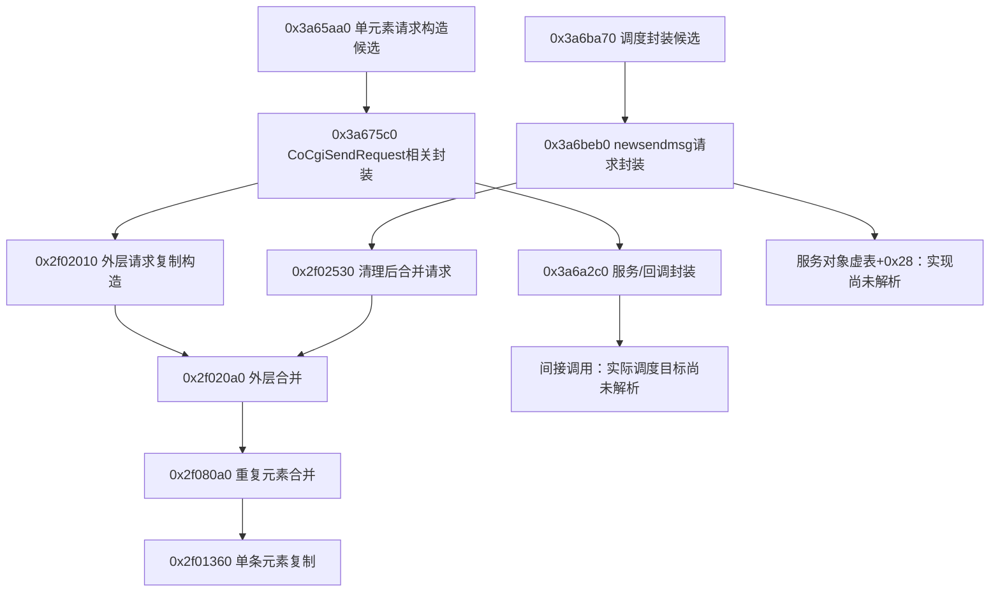

# Windows 微信 4.1.15.50：磁盘静态兼容性与发送调用图

## 最新：已定位静态候选链路，尚无可调用适配器

2026-10-05接续完成离线反汇编（349–353）。**本机 .50 的发送请求构造与部分调用链已有指令证据；线程/协程、对象生命周期、目标身份及送达结果契约仍未验证。** 下方343–348是先前仅检查PE和字节形状的阶段，不再概括当前分析深度。

分析输入仍是SHA256 `0cf6379405432385a1c442766443450f26a7689f45e53c1b4ad2822061f3113b` 的磁盘文件。只在忽略的 `data/send-disasm-20261005/deps` 解包并运行Capstone分析库；没有安装微信框架。轮子分发版本5.0.9、绑定自报5.0.7、原生API自报5.0，分别记录于[349工具清单](evidence/349-offline-disassembler-tool.json)，不把三者混写。用法依据[Capstone官方说明](https://www.capstone-engine.org/lang_python.html)。微信DLL只作为字节数据读取，没有加载执行。

### 1. 上轮字符串扫描漏掉了什么

[350](evidence/350-decoded-send-anchor-references.json)对两个可执行节中的四字节位移做候选筛选，再从所属异常表区间起点解码，核对指令边界与实际RIP操作数。76个候选中41个通过此项解码核对，7个没有所属异常表区间，未作为该扫描的已验证引用。它是有界静态分析，不能证明运行可达或穷尽所有寻址方式。

真正的路径字符串引用使用 **MOVUPS向量复制**，不是上轮检查的LEA形状：

| 所在区间起点（RVA） | 读取路径开头的指令RVA | 静态观察 |
| --- | --- | --- |
| `0x3a675c0` | `0x3a67a8e` | 读取`/cgi-bin/micromsg-bin/newsendmsg`，同区间含`kernel::foundation::CoCgiSendRequest`文本引用 |
| `0x3a6beb0` | `0x3a6bf2f` | 复制同一路径，构造请求封装并执行下游调用 |

三个类型的完整名称带`micromsg.`前缀；名字同样通过MOVUPS复制。名称之前96字节是函数指针表，构造代码将其写入对象首字段，表的`+8`指向复制该完整类型名称的方法。由此建立的是本机文件中的类型关联，不再只凭“附近有字符串”猜测：

| 类型 | 函数指针表RVA | 名称方法RVA |
| --- | --- | --- |
| `micromsg.MicroMsgRequestNew` | `0x9590158` | `0x2f01fc0` |
| `micromsg.SendMsgRequestNew` | `0x95901e8` | `0x2f02560` |
| `micromsg.SendMsgResponseNew` | `0x9590308` | `0x2f03950` |

### 2. 已核对的候选调用图

[351](evidence/351-send-candidate-callgraph.json)保存28个完整解码的异常表区间、28条已核对直接调用/跳转边、6个有直接调用或表指针依据的叶函数候选、3个类型表及字段观察。没有异常表条目不等于不是函数；叶函数的依据单独标注，不冒称有异常表认证。下图只展示其中一部分：

**没有证明G/U最终调到H，不把两段画成已接通的完整发送链。** 已发现相关回调对象、捕获对象的复制与引用计数操作，仍缺中间调度和生命周期解释。后续优先分析`0x3a6b270`下游的`0x3a6b640`、`0x3a6b490`以及服务虚调用，而非拿I做一个裸调用器。

### 3. 对象与字段：哪些已见，哪些仍是推测

外层`SendMsgRequestNew`分配路径申请`0x30`字节，重复元素分配`0x38`字节并使用`MicroMsgRequestNew`表。外层解析器`0x2f02210`会进入元素解析器`0x2f01850`，元素复制边界为`0x2f01360`。这与旧研究所提醒的“容器不等于单条消息”一致，但地址与结构依据来自本次 .50 文件。

元素序列化区间`0x2f01d10`读取`+0x34`存在位，并将以下偏移传给不同字段号的序列化调用：

| 字段号 | 元素偏移 | 存在位 | 本次观察 / 语义限制 |
| --- | --- | --- | --- |
| 1 | `+0x08` | `0x01` | 嵌套对象；构造候选把上游`+0x38`字符串复制到其中的字符串包装。可能为目标字段，尚未认证wxid或账号 |
| 2 | `+0x10` | `0x02` | 构造候选复制上游`+0x180`字符串。正文语义与旧研究相符，仍未用本机运行数据验证 |
| 3 | `+0x18` | `0x04` | 32位值，构造候选取自上游`+0x0c`；本轮不命名为已验证消息类型 |
| 4 | `+0x1c` | `0x08` | 32位值，取自上游`+0x164`；时间语义未验证 |
| 5 | `+0x28` | `0x10` | 来自辅助函数结果；不能当作认证的服务器消息ID |
| 6 | `+0x20` | `0x20` | 上游`+0x1c0`字符串；msgsource语义仅为旧研究提示 |
| 7 | `+0x2c` | `0x40` | 32位值；语义未验证 |

字段号/偏移是本次静态观察，目标、正文和msgsource名称只是结合[旧版研究](https://github.com/mosheng20205/WechatHook4.1.10.27/blob/713ec7d6f01d858e067a623c9bf2cda64d0d3e19/docs/SEND_MESSAGE_NOTES_4.1.10.27.md#L21-L39)的推断，不能据此提升真实入站或发送准入。没有读取真实wxid、聊天或运行时字符串。

请求封装构造`0x3a6c1f0`分别在`+0xa8`与`+0xd8`初始化请求/响应成员；访问器`0x113db0`、`0x113dc0`返回对应地址。`0x3a6beb0`先取得请求成员，再执行外层清理/合并。这里的布局证据不足以提供现存服务实例、有效回调、分配器所有权或正确协程上下文。

### 4. 返回值与旧偏移的进一步结论

请求封装候选在服务虚调用后，从对象`+8`取32位值，经ESI返回到EAX。**它的语义尚未确定，既不是已观察到的送达回执，也不能直接包装成`success=true`。** 所见`0x68f7c0`另有大量调用者，当前只能记为公共下游辅助函数，未证明其本身负责网络发送。

旧9个函数RVA中，navysoto的`DoSend`、`MsgCtor`以及aixed的`create_param2`、`send_message`共4个落在 .50 解码指令中间；旧`DoAddMsg` Hook点也落在指令中间。其余5个虽落在指令边界，仍是区间内部，且没有语义/ABI匹配证据。不能由对齐或函数表起点推导可用地址。

### 5. 本阶段验证与下一步

[353](evidence/353-send-disassembly-validation.json)重新核对磁盘哈希、解码范围、直接边、类型表、SIMD引用的位移计算、证据/文档链接与提交范围。只有同一执行者的静态复核，没有新增独立人员审查、产品回归或原生测试；不把既有369项结果用于证明微信兼容。

下一项是补齐上述间接调度链、服务对象来源、线程/协程及返回字段写入者，之后才能形成具体的隔离观察方案。真正最小化的双向运行、可靠账号/目标/消息身份和历史边界仍未验收，接收也尚未连Engine。没有安装微信框架、注入、读进程内存/密钥、恢复窗口、发消息或启用自动回复。[352](evidence/352-send-disassembly-checkpoint.json)只读保存状态仍为stopped/native_reader_timeout；最后最小化字段不是当前窗口认证。分析工具、完整反汇编与安装模块未提交，产品仍v0.1.22。

---

## 前一阶段：PE结构与字节形状核查（343–348）

2026-10-05（北京时间），接续[发送来源审计](NON_UIA_SEND_AUDIT.md)。本轮将静态检查推进到本机安装文件：只读磁盘上的 Weixin.exe 与 4.1.15.50/Weixin.dll，记录版本、哈希、PE 节、异常处理表及公开协议字符串。不加载 DLL，不访问进程内存，不取数据库密钥，不操作窗口，不发送。

**结果：精确磁盘构建已固定，但仍未定位可供本项目调用的 .50 发送入口。旧方案的 9 个函数调用 RVA 全部落在本机已登记函数区间的内部；不能直接套用旧偏移。** 这是新增的本机静态证据，不是运行兼容、最小化收发或 ABI 验证。

## 1. 本机文件身份

[343](evidence/343-disk-client-pe-compatibility.json)记录两个文件，文件版本与产品版本都为 **4.1.15.50**，PE 均为 AMD64 / PE32+。这确认了本机磁盘上的 Windows 构建，不采用搜索结果中 macOS 同号版本作为依据。

| 文件（相对安装目录） | 字节数 | SHA256 |
| --- | ---: | --- |
| Weixin.exe | 3,128,368 | a75c86e57a8ec581985f102c04d5125ce1d3f21a4043759a610ba01f06275255 |
| 4.1.15.50/Weixin.dll | 204,099,112 | 0cf6379405432385a1c442766443450f26a7689f45e53c1b4ad2822061f3113b |

Python 标准库一次只读分析之后，PowerShell 的文件版本资源、Get-FileHash、BinaryReader 分别重新读取并比对，结果一致。DLL 异常表包含 513,387 项，EXE 为 7,298 项。核对过程及范围见 [346](evidence/346-disk-pe-crosscheck.json)。两种实现由同一执行者完成，不称独立人员复审；只认证磁盘文件，不认证进程当前已加载模块的内存状态。

## 2. 旧 RVA 在新模块中的实际位置

依据 [Microsoft PE 格式](https://learn.microsoft.com/en-us/windows/win32/debug/pe-format)与 [x64 异常处理表](https://learn.microsoft.com/en-us/cpp/build/exception-handling-x64?view=msvc-170)，按节的 RVA/磁盘偏移换算，并读取包含目标 RVA 的 RUNTIME_FUNCTION 起止区间。异常表用于展开栈，不提供函数名称，也不保证覆盖所有叶函数；以下区间不能当成语义或 ABI 证明。

| 旧来源 / 名称 | 旧 RVA | .50 中所在区间起点 | 位于区间内的字节偏移 |
| --- | --- | --- | ---: |
| navysoto GetCoroCtx | 0x42010 | 0x41fd0 | 64 |
| navysoto GetMsgSvc | 0x334780 | 0x334470 | 784 |
| navysoto GetMsgCtx | 0x6c7a80 | 0x6c7a70 | 16 |
| navysoto DoSend | 0x1788af0 | 0x1788ae0 | 16 |
| navysoto SendEntry | 0x17419e0 | 0x17419c0 | 32 |
| navysoto MsgCtor | 0x72e830 | 0x72db40 | 3,312 |
| aixed create_param2 | 0xdf40 | 0xdf10 | 48 |
| aixed send_message | 0x1677a30 | 0x16777e0 | 592 |
| aixed txt_message_ctr | 0x6b2c30 | 0x6b2c20 | 16 |

navysoto 的这些常量来自已固定的 [.11.52 偏移表](https://github.com/navysoto/wxhook/blob/fbccd52713f8cc7cd1023f852bf625af4fe38624/WeixinHookCs/src/WeixinHook.Native/WeixinOffsets.cs#L20-L35)；aixed 来自本轮补取的 [.10.27 global.h](https://github.com/aixed/WeChat-Hook/blob/e905d07ade50d2c6472e4eb3bd4f3fe19cf662c6/include/global.h#L75-L87)，哈希见 [344](evidence/344-send-compat-public-refs.json)。静态检查没有把这些地址用于函数调用或断点。

另检查了 navysoto 的 DoAddMsg：本来就是函数内 Hook 点，因此“位于区间内”不能用作新的不兼容判据；这里只记录它在 .50 对应区间偏移 15，身份仍未知。aixed 的 6 个数据地址仍可映射到 .rdata，也不代表相同 vtable/全局对象。9 个函数、1 个 Hook 点、6 个数据位置共 16 项全部保留未验证状态。

不能把表中的区间起点当作“修正后的发送地址”，也不能统一减去偏移来移植。需要逐个证明函数语义、参数、对象布局、调用约定、线程与生命周期；本轮没有完成这些证明。恰好落在可执行节或某个区间起点也不会自动通过。

## 3. .50 自身的发送相关字面量

[345](evidence/345-disk-send-literal-anchors.json)只保存已知公开协议/类型名称的位置，没有读取聊天库或运行时正文。

| 公开字面量 | .50 RVA | 观察 |
| --- | --- | --- |
| /cgi-bin/micromsg-bin/newsendmsg | 0x96d8fb0 | 1处，.rdata，后接 NUL |
| SendMsgRequestNew | 0x9590251 | 1处，.rdata，后接 NUL |
| MicroMsgRequestNew | 0x95901c1 | 1处，.rdata，后接 NUL |
| SendMsgResponseNew | 0x9590371 | 1处，.rdata，后接 NUL |

旧版本的[发送研究笔记](https://github.com/mosheng20205/WechatHook4.1.10.27/blob/713ec7d6f01d858e067a623c9bf2cda64d0d3e19/docs/SEND_MESSAGE_NOTES_4.1.10.27.md#L1-L39)区分外层请求容器与单条消息元素。本轮没有把这份 .10.27 对象字段映射到 .50。

临时扫描只覆盖两种 REX 前缀下的 RIP-relative LEA 字节形状、字面量前40字节附近，以及指向字面量的64位绝对地址形状，均未找到对应引用。它不是反汇编：不验证指令边界，不覆盖所有寻址/间接表/运行时构造，也不证明代码从不使用这些字符串。117 个具名导出中未匹配 send/msg/message/coro 名称，同样不能证明内部没有发送能力。**当前只有定位线索，没有可调用发送接口。**

## 4. 公开分支复核与下一步

[344](evidence/344-send-compat-public-refs.json)保存 aixed、navysoto 和 mosheng 的公开分支/标签索引。本轮发现的 mosheng codex/realtime-message-wxid-autoreply 分支是已审计主线的祖先：ahead 0、behind 5，不能当作新增适配。只查这些仓库索引及限定公开搜索，不宣称所有 forks、私有实现或未索引项目均不存在 .50 支持；没有下载 release 二进制。

**下一项具体工作是对上述固定哈希的 .50 DLL 做离线反汇编和调用关系分析。** 先以这些字面量、请求类型及其间接引用为线索，识别请求构造/提交位置，再追踪目标 wxid、消息元素布局及线程调度，交付带证据的候选调用图和不确定项。只有语义成立才讨论隔离适配；不能以字符串 RVA、异常表起点或旧版结构直接编造调用器。

当前环境的 PATH 未找到本轮查找的 dumpbin/objdump/llvm-objdump，捆绑 Python 未带 capstone/pefile/lief。本轮未安装新分析依赖。后续工具准备应继续服务于磁盘静态分析，不安装微信 Hook 框架、加载候选 DLL 或连接账号；如确实进入安装框架/注入/取密钥/发送阶段，仍按现有授权边界单独处理。

## 验证与范围

[346](evidence/346-disk-pe-crosscheck.json)复核两个文件的版本/哈希和10个代码位置的区间；[348](evidence/348-send-compat-static-validation.json)核对来源常量、证据结构、报告链接与提交范围。临时分析脚本在忽略的 data/send-compat-20261005，仅为本轮离线研究，不是产品命令或兼容适配器。二进制及其代码字节没有提交或上传，只有哈希、公开地址/结构元数据和结论进入证据。

[347](evidence/347-send-compat-checkpoint.json)读取保存状态仍为 stopped/native_reader_timeout，24569成功快照、24505最小化、unknown1，防待机请求不活动；最小化字段仍仅最后观察。未重启监听、恢复窗口、改电源或处理积压。产品仍 v0.1.22，真实接收尚未连 Engine，自动回复关闭；未运行产品回归、13项原生测试或第三方候选，未读 .env/密钥或让真实聊天进入模型/记忆/发送。
