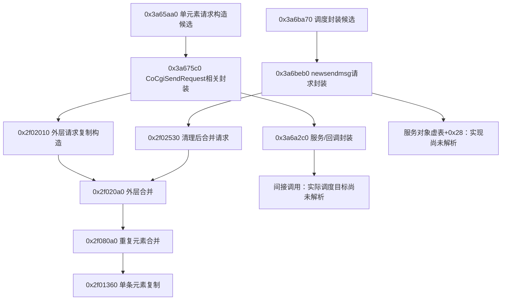

# Windows 微信 4.1.15.50：磁盘静态兼容性与发送调用图

## 最新：子任务可跳过，下层结果采用OR而上层采用AND（410–413）

2026-10-07继续固定哈希DLL磁盘只读。**已找到两类组任务共用的下层调用体，并追到一个嵌套存储任务的结果字节生产处：在非空map的0/1值域，它表示至少一项为真，不能解释为整批全部成功。** 实际事务提交、账号和订阅者仍未认证，没有可运行适配器。

### 创建的任务不一定覆盖所有子分组

[410](evidence/410-inbound-child-dispatch.json)分别核3974b20和397a140。各自以DWORD子分组键调用3977720/397cd40，经不同provider和动态类型转换取得对象；空对象进入诊断/清理后继续下一组，绕过子任务创建与插入。所有创建完成后才把结果累积byte置1，并对已创建任务的结果做AND。故缺对象的子分组不是自动加入一个false结果；空任务迭代仍保留初值。这里只认证所选条件路径，未运行复现，也未认证10a3240分类或provider的账号/分片含义。

正常子任务经3977800/397ce20、3978890/397d450、39789c0/397d580构造并提交。两张表96b9f88和96ba2a8的+10都指向3978e90，它调整RCX+8后跳到3979070，再调3979350→3971490。捕获的输入mode和返回byte是不同字段；scope状态fallback、实际执行器、取消和退出仍缺。

### 下层结果的精确规则

[411](evidence/411-inbound-storage-result.json)中3971490含公开标签TaskInnerAddMessageListToDB，以及query/filter duplicate svrid阶段名称。这些只是磁盘常量，不认证协议ID域或运行去重效果。过滤后容器计数为零时可返回空向量和byte1，跳过后续嵌套任务。

非空所选路径把39b0de0函数地址写入任务+8；30077d0包装后经显式或默认调度入口提交，包装体3007a30取回原任务基址调用+8。39b0de0调用155b940（公开标签AddMessageMap），取得返回map后分别选择向量和计算byte：

| 阶段 | 已核指令行为 | 判据限制 |
| --- | --- | --- |
| map为空 | 保留初始byte1，返回向量为空 | true不证明新增或保存任何消息 |
| 选择向量 | b7c80按字符串键取得node+30的byte；恰为1才复制该键的项目，步长744字节 | 缺键进入异常；非零不一律等于1，身份及完整项目对应未知 |
| map非空归约 | acc从0开始，逐项`acc=(acc&1)\|node_byte` | 在0/1值域是OR；任意byte不保证规范化，不是上层AND |
| 返回 | byte存入typed+20，即payload+18；promise正常resolve；经3971490/3979350/3979070返回 | promise完成与处理byte不同，事务持久化仍未认证 |

所选0/1推演中，`[1,0]`和`[0,1]`均可得到byte1和部分选择结果。之后407的子任务/组汇总仍是AND：两层AND不能把下层“至少一项为真”提升成“所有原项成功”。这不是实机失败复现、完整CFG可达证明、事务回滚结论或新来信判定。

155b940内另有fe6240回调操作边界；所查第二次返回值单独保存并用于格式化，map通过15045e0转出。尚未核完整回调与map值写入，不能据此声称提交成功、失败或忽略提交错误。下一项优先这些回调、map字节生产者及事务边界，再补重复过滤/原项对应、真实+e8订阅者和root+68身份来源。

### 验证与运行边界

[413](evidence/413-inbound-storage-validation.json)重新读固定DLL并复核区间、叶函数、表、直接边、RIP、字段和离线算术投影；同一执行者，无独立审查或运行验收。409的10个历史脚本哈希保持。[412](evidence/412-inbound-storage-checkpoint.json)保存监听仍停止，不代表当前窗口状态。七份文档及[观察方案O6](ISOLATED_OBSERVATION_4_1_15_50.md)已更新，历史证据不改。产品0.1.22、自动回复关闭，未加载目标DLL、访问进程/数据库、真实发送或运行产品/原生测试。后续从414起。

## 最新：分组后端与两层结果位，不能将完成等同于来信（406–409）

2026-10-07继续固定哈希DLL磁盘只读。**已追到默认后端按数值标签分组、两层任务结果汇总，以及输出标志的直接生产者。该标志没有获得“新来信”或逐条成功语义。** 实际订阅者和账号来源仍缺，无可运行接收适配器。

[406](evidence/406-inbound-backend-groups.json)延伸403的`38de5a0`。模块公开标签为`AddMessageListToDBForSync`；这是磁盘代码里的名称，没有读取或操作聊天数据库。分组循环先调用`a7b9f0`选择当前端点，再经`158a900`取得数值tag。空端点返回0，所选非空分类路径返回1或2；循环以无符号`tag-1<=1`限定只追加1/2。map节点的`+10`保存DWORD tag，`+18`起为744字节元素向量。因此这里是按数值类别分组，不是按好友字符串分组，也不是协议rawtype的1/2。分类谓词和当前账号/指定好友身份仍未认证。

### 外层返回标志来自逐组累积

tag1/2走不同任务构造分支。结果循环通过`38e2980`等待共享任务，再取得promise值并检查存储类型；缺值或类型不符存在异常分支。正常结果是向量和字节`+18`。

| 已核阶段 | 固定字节行为 | 能证明的范围 |
| --- | --- | --- |
| 初始化 | 新建返回map；累积byte置1 | 空迭代也保留1，不能证明处理过消息 |
| 等待结果 | 取组结果byte+18；逐组按位AND | 是汇总，不是逐条状态或事务提交证明 |
| 收集组 | byte非零时，将结果向量移入以原数值tag为键的返回map | 原始项到结果项的完整对应和变换仍缺 |
| 返回 | 185e4a0移动map前64字节，另写output+40为累积byte | map首DWORD 3f800000是负载因子，不是成功码 |
| 通知门槛 | 403调用方检查output+40 bit0 | 清位进入该处诊断/清理路径，跳过所查+e8通知分支 |

所选正常汇总逻辑允许“一组非零、一组为零”：返回map可能保留部分组数据，总标志却为0。**这不等于所有项失败、事务整体回滚或先前处理没有副作用。** 只能说明403不走这一处信号循环；其他通知、恢复/重试及持久化效果未认证，也没有运行复现该情形。

后端的空输入分支明确返回空map并写`+40=1`；但403本身会在空输入时跳过后端，所以不是空批次发信号的证据。true、非空结果和输入数量必须分别记录。

### 组任务内部还有一层汇总

[407](evidence/407-inbound-result-aggregation.json)确认所选闭包表`96b9e48+10=39747a0`、`96ba208+10=3979e90`，分别以mode1调用`3974b20`、`397a140`。包装器将返回向量和byte装入typed promise payload，随后调用resolve helper `3b3880`，没有要求byte非零。正常resolve可以携带处理标志0，不能把promise完成当业务成功。

两个处理器已分别核对，未仅凭函数相似外推：各自将累积byte置1，等待更下层子任务，按位AND子结果byte+18，选取非零子结果向量追加，最终返回向量及累积byte+18。因此须区分**子任务结果→组向量/组标志→外层tag map/总标志→本地通知**。部分向量与失败汇总可在某一层共存，不能压成一个`success`或当作可靠新来信准入。

第一个处理器读取内部`+164`后传入`10a3240`；第二个也读取同一字段。394已将该位置追到协议字段9，但本轮未认证选择器的完整含义、单位、日历/存储分片或更下层结果位生产者。不得用这一数字推断历史边界、事务完成或消息刚到。

### 信号来源仍需绑定

补查发现`17a00d0`复制传入消息、构造单元素向量后以receiver`+e8`调用`17cac20`；`17ff300`也以receiver`+e8`调用同一派发器。它们的真实receiver实例、调用原因和与本次同步批次的身份对应尚未认证，属于额外代码入口，不能仅凭相同偏移/派发器推断某个运行实例或专属新来信事件。

有限的`+e8/+f8`成员及LEA/ADD候选扫描未闭合真实订阅者；命中的构造/析构、其他对象同偏移和字符串字段没有被提升为注册证据。下一项仍是实际订阅注册/捕获回调，以及更下层子任务结果、存储提交和root`+68`账号来源；原项保留、最终方向、首批/历史/重连/换号、缓存reset和执行器退出继续保留。

[408保存状态](evidence/408-inbound-backend-checkpoint.json)仍为stopped/native_reader_timeout，文件哈希不变；不是当前窗口检查。[409](evidence/409-inbound-backend-validation.json)为同一执行者固定字节、分支/表槽与离线汇总投影复核，保留405列出的10个历史脚本。未执行产品/原生/并发/网络测试，未访问进程/密钥/聊天库或发送。产品0.1.22、自动回复关闭，[观察方案](ISOLATED_OBSERVATION_4_1_15_50.md)仍停在设计阶段。

## 最新：消费者检查已追到分组通知，实际订阅者仍缺（402–405）

2026-10-06继续固定哈希DLL磁盘只读。**本轮补上入站转换后的检查、第二个键容器，以及分组通知到回调包装器的条件路径。仍未认证最终账号、方向或实时新来信。** 未加载或执行目标DLL，无可运行接收适配器。

### 转换后仍有检查和对象变化

[402](evidence/402-inbound-consumer-gates.json)延伸397的实际消费者`17cb2c0`。调用`a794a0`后仍调用`a7cd20(mode1)`；后者不是已证明的普通文字空操作。随后检查内部`+148`：零值跳到公共处理，非零值进入另一段查找且可能经`a82200`替换对象。因此不能把此检查解释成“无ID直接拒绝”，也不能据继续执行宣布ID有效或消息最终通过。

公共处理之后还有`abe9e0`、`17cda50`、`17c7fb0`分支；没有给未核谓词命名为“历史消息”或“自身消息”。其中`17cda50`以当前端点字符串和内部`+148`构造键，在`manager+bf8`所指内部对象的`+2c0`容器查找。命中时再构造键并调用`17d4840→1d1010`；选定匹配节点路径可见摘链、减计数和释放，之后返回原命中值，消费者跳过当前项。未命中不走该删除调用。

这与398准备阶段的全局`bb8cc60`是**两个不同容器**。尚未认证键的完整格式、写入者、并发、过期/清理、账号作用域、换号和重连行为；一次命中后删除不能推出全局去重或恰好一次处理。

`a7b9f0`重新从当前内部对象选端点：普通非10000分支中，`+18`非空且与root虚槽`+20`字符串相等才返回`+38`，否则返回`+18`；不是简单返回已有`+58`缓存。root实际成员生产者和账号语义仍缺。本轮有界赋值候选扫描中，`474c0`的`[rdx+68]`写入属于输出对象，已排除为root成员证据；未穷尽搜索，不能声称不存在生产者。

`17c5700`按当前rawtype/subtype找handler；空结果绕过此处检查，有handler则调用虚槽`+38`，返回false跳过追加。381默认注册对应的Text表`96b69e8+38=73610`只返回true；这与399的默认descriptor表`9078b48+10`是不同角色，虽共用短函数，不能混同。活跃handler仍未绑定，常量true也不认证账号或方向。

选定后续追加分支将局部数值写入内部`+178`，清字节`+2a8`，追加`0x2e8（744）`字节对象。`+178`不同于协议字段6来源的`+168`；均不因数字值而获得可信方向语义。`a7cd20`、非零ID替换、其他分类及后续`17cdcf0`变换尚未完整追完，不能据单个赋值宣称最终对象固定。函数正常尾部返回true也不表示每项已交付。

### 分组结果才是这一处通知的输入

[403](evidence/403-inbound-group-notification.json)限定于局部两计数合并为零的分支：`17cdcf0`处理批次后，消费者以同一局部向量调用`17c8eb0`，传入的options`+38`已清空；非零计数另有路线，不泛化为全部普通文字。

| 阶段 | 固定字节所见 | 尚未认证 |
| --- | --- | --- |
| 批次输入 | 空向量跳过主体；无override时调用manager+c80的38de5a0 | 后端业务/存储含义及原项保留规则 |
| 后端结果 | 输出分组结构byte+40的bit0为选定通知门槛；清位走诊断/清理 | bit0不是已认证成功、新来信或送达 |
| 通知前处理 | 存在17c9c50、2df1ee0、17c8340、17caac0调用 | 各阶段可能重写/分类；完整效果未知 |
| 发出信号 | 遍历结果节点，将node+18向量传入manager+e8的17cac20 | 不等于原始批次每项原样交付；不是另一条manager+168信号 |

`17cac20`在锁和其他状态条件下遍历订阅节点。节点`+48`无executor时，以`node+8`上下文、`node+18`捕获存储和分组向量调用`node+10`函数指针；这里是捕获的函数指针，**不是对象虚表槽**。

有executor时，`ac2940`分配向量并以744字节步长调用逐元素复制helper `1cab70`；复制不证明嵌套对象独立。随后构造128字节闭包、安装表`9288008`，通过executor虚槽`+8`提交holder。闭包表`+10=485830`的19字节包装器把`closure+68`向量、`+18`捕获存储、`+8`上下文传给捕获函数指针`+10`。这闭合了参数包装路径，但还没有定位实际订阅者及其注册，也没有证明执行器运行、取消/排空、应用事件或实时消息交付。

下一项优先追`38de5a0`结果分组和标志语义、`manager+e8`订阅者/注册、root`+68`成员/字符串身份；继续保留最终方向、过滤状态、时间调整、缓存reset及首批/历史/重连/换号边界。原发送scope/通知/退出缺口仍未替代。

[404保存状态](evidence/404-inbound-notification-checkpoint.json)仍为stopped/native_reader_timeout；24569快照、24505最小化、unknown1，防待机请求不活动。这是保存文件，不是当前窗口检查。[405](evidence/405-inbound-notification-validation.json)为同一执行者固定字节/表/指令和文档静态复核，401列出的8个脚本保持；无独立审查、产品/原生/网络运行测试或真实发送。产品0.1.22、自动回复关闭，[观察方案](ISOLATED_OBSERVATION_4_1_15_50.md)仅更新设计。

## 最新：普通入站集合已接到条件批处理，账号和新旧边界仍缺（397–401）

2026-10-06继续。**本轮补上同一普通文字集合到批次转换器的静态路径，并确认时间值不能直接作为新来信依据。** 仍无可运行接收适配器；账号、好友、最终方向、首批/历史/重连边界尚未认证。只读同一固定哈希DLL磁盘字节，未加载或执行目标模块。

[397](evidence/397-inbound-batch-consumer.json)追同一所有者：`2ea2f60`以同一manager调用`2ea6840`，命令5经393已核入口把type1追加到`owner+1d0`子管理器的`+8`集合；外层随后把同一子管理器传给`2eb8870`。后者读取同一集合并以`submanager+58`作为过滤状态，进入`2eb8a20`。模式参数来自数字19的比较，尚不命名为“实时”或“历史”。正常分支最后清理原集合，但不证明全部异步工作完成。

批次路径为`2eb8a20→2eb9af0`准备扩展元素，经条件过滤后`2ebd6a0→17cb2c0→a794a0→a773b0`。源元素步长为`0x70（112）`字节，扩展元素和消费批次为`0x78（120）`字节。这里的消费者身份来自实参及同一集合字段；394另存的`17d4b60`不是这条队列的证据。准备函数有两种模式、重复候选过滤和额外分支；普通type1还经过`2eb3780`，返回true时不追加消费批次。因此不是“所有入队项均转成已交付来信”的结论。范围函数还接收比较器`2eb3290`，其排序含义尚未核定。

### 时间字段须按阶段区分

| 阶段 | 已核赋值 | 限制 |
| --- | --- | --- |
| AddMsg协议部分 | 字段9位于DWORD +48；394内层转换写内部+164，并乘1000写+150 | 字段名/时钟/新旧语义仍未认证 |
| 扩展构造a7bbd0 | 字段9非零直接零扩展乘1000写额外QWORD +70；零时改取4ff70返回低32位再乘1000 | 此构造不改原字段9；fallback时钟的锚点和单位未完整绑定 |
| 批次准备2eb9af0 | 另有2ad2de0、2ad2760返回值写入同一额外+70的分支 | 初始换算不保证保留；调整策略仍缺 |
| 扩展转换a794a0 | 调用a773b0后，额外+70覆盖内部+150 | 394描述的是内层赋值点，不是最终批次值 |

`4ff70`使用root成员`+2e8`并转到`30ccd0`，后者存在计时值减锚点加偏移和另一fallback分支；不能直接称为可信当前到达时间。**非零内部时间不能证明源字段存在、消息刚到、时钟可信或历史边界已过。** 适配器仍不得自行补当前时间让旧消息通过准入。

`2eb3780`的一个已核拒绝分支：状态`+148==1`、首DWORD阈值非零且AddMsg部分字段9无符号小于等于阈值时，返回true；flag不为1则返回false。该比较读取字段9，位置不同于扩展`+70`。阈值/flag的生产者、后续map分支以及是否代表历史界线仍待追，不能当作完整准入策略。

### 端点键、账号来源与重复候选

[398](evidence/398-inbound-key-root-filter.json)确认：rawtype非10000、字段2非空且与root虚槽`+20`字符串相等时，键选择字段3，否则选择字段2。这解释了条件性的端点选择，但尚不足以认证谁是当前账号或指定好友。

结合355已核构造表，root表`8f294e8+20=4f3c0`，其中虚槽`+60=469a0`返回root的`+68/+70`共享对象/控制块，再调用该对象虚槽`+18`获得字符串引用；缺对象则返回静态空字符串。**实际root+68的生产者、成员表与虚槽+18、账号变化及返回引用生命周期仍缺**，没有读取当前账号。空字符串不能充当有效身份。

普通type1在`2ebc6c0`用所选端点字符串和字段12 QWORD查全局`bb8cc60`；命中返回true，准备阶段跳过该候选；未命中调用更新helper后返回false。type10000另有特殊判断，不套用上述简化。所查入口没有字段12非零保护，393的可缺失/default-zero仍有效。通用容器插入细节、淘汰、缓存清理、账号作用域和重连边界未核定，不能复用为跨会话唯一键或恰好一次处理保证。

### 默认descriptor缩小了未知范围，但方向仍未闭合

[399](evidence/399-inbound-default-descriptor.json)限定于新构造内部对象、rawtype1、首端点不为模块常量`newsapp`：类型判断落到`a7e790→a84600`，安装默认表`9078b48`；其`+10=73610`仅`mov al,1;ret`，因此这一选定虚调用不会改消息。已有descriptor、newsapp及其他类型不在此结论内。

该默认descriptor的`+148`初始化为零，所以之后`a78ef0`跳过辅助布尔设置。内部`+2c0`仍只是处理标志；不能从它或`+258→+9`推出可信`is_self`。实际批次消费者随后还调用`a7cd20`并按ID候选进入其他分支，这些最终变换/事件派发未追完。这里解决了一个具体虚调用的实现，未认证整个最终对象。

下一项：root+68的生产者/成员虚槽+18；过滤状态、时间调整和缓存reset；首批/历史/重连/换号；`17cb2c0`后续方向与真实通知。指定好友、ID域以及发送订阅者/实际scope/退出缺口继续保留。

[400保存状态](evidence/400-inbound-owner-checkpoint.json)仍为stopped/native_reader_timeout，24569快照、24505最小化、unknown1，防待机请求不活动；不是当前窗口检查。[401静态复核](evidence/401-inbound-owner-validation.json)重新读取固定字节、核范围/指令/表及条件投影，保留396列出的11脚本哈希。仅同一执行者复核；没有产品/原生/并发/网络运行测试，0.1.22、自动回复关闭，[观察方案](ISOLATED_OBSERVATION_4_1_15_50.md)未实施。

## 最新：AddMsg对象已定位，普通文字入队后的关联仍缺（393–396）

2026-10-06继续。**本轮确认了命令5使用的AddMsg类型及其字段赋值来源；这还不是可用的实时接收适配器。** 普通type1的队列身份、账号/好友、方向与历史边界仍未认证。范围为同一固定哈希DLL磁盘只读，未加载或执行目标模块。

### 类型、解析与普通文字分支

[393](evidence/393-inbound-addmsg-dispatch.json)记录同步上下文的`2ea6840`命令遍历：外层参数的嵌套`+8`列表提供数组和实际数量，命令项`+10`为5时调用`2ea9f60`。后者通过`108e7a0`构造0x70（112）字节局部对象并安装表`916ea28`；表`+8=1092a20`以两段重叠立即数写出`micromsg.AddMsg`。名字不是连续存放在只读字符串区，不能仅靠字符串搜索排除该类型，也不能混用另一类型AddBypMsg。

命令缓冲的嵌套字符串交给`694640`，此处明确检查AL；false跳过`2eb4b10`。通用解析先调用对象表`+38`解析，再经`+20`验证必填项，最后结合流状态。**此调用点没有363所查发送响应封装强制返回true的行为。** 外层在所选调用点未检查命令处理的AL，不代表整个同步系统无错误处理。外层NewSyncResponse生产者/类型绑定也尚未完全追到，不以附近配置名代替对象身份。

AddMsg表`+48=1092310`给出15项字段号/偏移映射，`+20=10929a0`要求presence mask `0x1ff`并检查有关嵌套对象。字段12的bit `0x800`及字段15的bit `0x4000`不在必填mask内；字段12在构造时默认零。因此“解析成功/有对象”不足以保证该ID候选存在或非零，嵌套与流检查仍须分别保留。

`2eb4b10`读取字段4的原始类型。type1在集合非空指针条件下走复制追加，每项0x70（112）字节，容量满时走增长分支；缺集合则退出。**直接`38b2310→a773b0`分支属于type37/65，不能作为普通文字即时消费路径。** [394](evidence/394-inbound-field-provenance.json)另记录`17d4b60`遍历0x70（112）字节元素并调用转换器，以及直接调用者`3a93e70`；尚未把该向量和同步入队集合接成同一对象，不能凭元素大小相同补这条边。

### 内部字段的来源与可用范围

以下均为`a773b0`选定赋值点，字段名暂用数字，不从旧版本协议推测正式含义。

| AddMsg字段 | 来源偏移 | 内部目标 | 本轮能确认的关系 |
| --- | --- | --- | --- |
| 12 | QWORD +50 | +148 | 直接复制；来源ID候选，未认证非零、唯一性或账号作用域 |
| 2 / 3 | +8 / +18的嵌套字符串+8 | 字符串+18 / +38 | 两个端点候选；尚未认证自身账号与指定好友 |
| 5 | +20的嵌套字符串+8 | 字符串+180 | 正文候选的复制来源 |
| 9 | DWORD +48 | +164、+150 | DWORD复制，另零扩展乘1000；不是新旧边界或可信时钟证明 |
| 6 | DWORD +28 | +168 | 协议来源数值，不是已认证的收发方向 |
| 13 / 15 | DWORD +4c / QWORD +60 | +174 / +248 | 数值复制；不能直接称历史游标 |
| 4 | DWORD +14 | +c | 经a786f0设置原始类型 |

386已经确认发送响应item字段8也写内部`+148`；这只建立共同目标位置，**不证明两个协议字段同ID域、跨账号稳定或可作去重键**。382发送目标普通分支取内部`+38`，本轮补它的一种协议来源，仍没有认证好友身份。入站协议字段6进入`+168`，不可把此前发送时写2/5的本地状态解释成收发方向。

端点字符串选择使用`45d10`返回对象的虚槽`+20`字符串以及类别判断；该槽实现与账号会话生命周期未绑定。原始type10000另有端点改写。转换末尾`a78d60`还调用descriptor虚槽`+10`，可能继续改消息；其`+2c0`处理标志不是方向证明。随后`a78ef0`仅在descriptor及其`+148`满足条件时设置辅助布尔，`+258→+9`既有特殊默认true分支，又有与上述未绑定字符串“不相等”的比较，不能直接套成`is_self`。因此上表不能扩成所有类型最终对象内容不变的承诺。

### 剩余工作与验证范围

下一项优先：普通type1入队集合的生产者/消费者身份；root虚槽+20账号字符串的实现与生命周期；descriptor+10最终变换；首批、历史同步、重连和换号边界。来源ID零值/重复作用域、指定好友认证以及发送通知实际订阅者继续保留缺口。不得给首批补当前时间或伪造方向后交给Engine。

[395保存状态](evidence/395-inbound-contract-checkpoint.json)仍为stopped/native_reader_timeout，24569快照、24505最小化、unknown1，防待机请求不活动；保存的窗口状态不是当前认证。[396静态复核](evidence/396-inbound-contract-validation.json)核对固定字节、函数范围、指令、表、原始位移、立即数类型名及字段号。必填mask案例仅为位运算推导，不是执行解析器或接收测试。旧6脚本保持；没有产品/原生/运行测试，0.1.22、自动回复关闭，[观察方案](ISOLATED_OBSERVATION_4_1_15_50.md)仍未实施。

## 最新：最终整体状态、本地状态和通知需要分开判断（389–392）

2026-10-06继续。**文字处理器的所查最终分支并未把逐条错误提升为整体错误；本地通知和上层promise完成也不能直接代表好友收到。** 本轮追到了最终结果重包、本地信号及上层有条件的第二次调用，仍没有运行适配器或执行真实发送。

### 从共有输出到本地状态与重包

[389](evidence/389-send-text-final-notification.json)接续386：`0x3a7cdd8`先把公共结果A/B复制到文字输出，再在`0x3a7d173`读取原payload `+0x168`。该值等于2时跳向后续通知；不等于2时在`0x3a7d23b`写5，然后通过`0x39d3c60`重建一个本地结果。

此构造器的输入是原整体A/B与独立元数据`[3,12]`。它保留A，先置B为0，再复制非零的原B；没有收到逐条item状态。元数据写进新分配对象，不是把A/B改成3/12。**在“整体0/0、首条非零进入共有输出、原本地状态不是2”的选定分支条件下，可得到本地状态5而构造后的整体仍0/0。** 这是由指定指令推导的条件案例，不是已复现的客户端故障，也不是对65KB文字函数全部控制流的认证；状态2/5的业务枚举名仍未定。

这一分支还把新构造对象复制到最终输出`+0x28/+0x30`。因此，公共网络结果的`+0x28`虽曾指向`SendMsgResponseNew`，**最终handler结果同偏移可以承载另一个本地元数据对象**。后续观察必须记录结果所在层与对象类别，不能把同一偏移当作同一种协议响应贯穿全链。上层会继续复制最终A/B、字符串及共享对象，不会仅因类型相同就恢复原始逐条响应。

### 通知是本地信号，订阅者还未认证

文字所查分支在`0x3a800fe`把原消息payload交给`0x39c88f0`，参数mode=1、emit=1。该helper尝试取得handler `+0x398/+0x3a0`的弱引用manager；取得对象后调用更新helper `0x38efc20`，再检查返回对象byte `+0x2e8`。只有该条件和emit标志满足，才经`0x39bcb50`向handler `+0x98`的信号对象传递数值`0x800000000`。

`0x17ff430`按订阅者字段分支：无executor时直接调用订阅回调，有executor时封装后通过executor `+8`派发，并有信号重入诊断。实际订阅者、更新helper的完整副作用、返回byte和数值事件的正式名称没有闭合。**不能把该信号命名为“对端送达”，也不能把排队或回调返回代替对端证据。** 本轮只读取代码，未调用更新helper或触及聊天数据库。

### 上层第二次调用有原始类型限制

[390](evidence/390-send-upper-reentry-result.json)确认上层闭包`0x1865d60`不是无条件连续调用两次：第一次`0x186600e → 0x1866a60`返回整体A/B非零后，才调用`0x39ca2a0`。后者要求以下条件同时成立：

- 请求、payload和标志对象均非空，整体B等于102。
- 请求数字状态`+0xbc`等于10；该状态在所查发送调用前写入。
- payload原始类型`+0xc`等于49，子类型`+0x10`为6或130。
- 请求`+0x28`所指byte非零。

满足时先清该byte，再在`0x18662bc`复用同一捕获request和handler调用`0x1866a60`，并以第二个结果覆盖第一个。原始类型1不满足这个上层判据；381中一些类型49归一到注册key1，不意味着所有TextMessageHandler请求都是普通文字。这里不猜102的错误枚举名或6/130的业务名称。

`0x1866a60`先经handler `+0xc8`预检查，整体为零才调用`+0xd0`。默认文字表的预检查`0x39c72b0`提供A/B=0/0，但活跃表和替换情况仍须另证。最终闭包通过`0x1809b20`把结果复制到request `+0xa8`的promise，resolve状态1不要求A/B为零。尾部另调用`0x1802d10`，参数来自closure `+0x30`；不能只凭这个尾部调用宣布同一请求又被重发。

| 关联层 | 当前静态依据 | 不能替代的身份或判据 |
| --- | --- | --- |
| 逻辑请求 | 捕获request及其`+0xa8`结果promise | 账号、好友或一次网络提交 |
| handler调用 | 首次调用与上述受限第二次调用 | 原始消息类型或公共尝试次数 |
| 公共尝试 | 385剩余预算、每轮请求副本与timeout | 整次操作时限、底层网络次数 |
| 本地任务 | 355/358/364任务号、wrapper和回调映射 | 逻辑请求、目标或对端消息ID |
| 最终结果/通知 | 本地状态、分层结果对象、promise与信号 | 解析有效、逐条成功或好友收到 |

以上分层是关联设计，不是已采集的运行轨迹。内部预算与上层调用不能相乘成全局网络次数保证；服务端去重、下层重传及完整异常路径仍未知。本项目未添加重试，结果不明仍不主动重发。

[392](evidence/392-send-text-final-validation.json)新读固定哈希DLL，复核16区间、4叶函数、23直接边、2表、156观察和110字段/分支断言；另核3指定表目标、7上层判定推导、3空值判定和2本地结果推导，前轮6脚本哈希不变。同一执行者静态复核，不是运行或独立审查。[391](evidence/391-send-text-final-checkpoint.json)保存监听仍停止；产品0.1.22、自动回复关闭。

下一项优先补**入站ID/方向/历史及账号/目标来源、实际通知订阅者和更新结果语义**，同时保留实际对象/执行器、异常与最终退出缺口。[观察方案](ISOLATED_OBSERVATION_4_1_15_50.md)已加入handler调用层、最终对象类别及本地通知边界。下方“完整最终返回未追”是前轮状态；本轮只补选定正常分支，未认证全部文字路径。

---

## 最新：文字默认允许一次内部重试，首条响应仍缺目标匹配（385–388）

2026-10-06继续。**上一轮未定含义的options首DWORD，现已追到公共封装的本地重试预算。文字默认值1允许本层额外尝试一次，位置默认0不在该循环重试。** 本轮也直接核对了文字入口的整体状态、首条响应及字段回写。进展仍来自固定DLL磁盘字节，未执行微信发送或增加适配器重试。

### 重试依据什么，次数与时间限于哪一层

[385](evidence/385-send-text-retry-budget.json)：`0x3a675c0`在进入循环前把options首DWORD复制到`rbp+0x27c`。每轮调用`0x3a6a2c0`取得整体结果后，读取结果`+0/+4`的两个状态，以下记为A/B。其正常控制流的再次尝试条件为：

`(A或B非零) 且 (A为0或-110) 且 (剩余预算非零)`

| 所查状态 | 剩余预算 | 本层正常路径 |
| --- | --- | --- |
| A=0，B=0 | 1 | 结束本循环 |
| A=0，B非零 | 1 | 等待后再次尝试 |
| A=-110 | 1 | 等待后再次尝试 |
| A为其他非零值 | 1 | 结束本循环 |
| 整体结果有错误 | 0 | 结束本循环 |

等待正常返回后才在`0x3a67b9d`减一，设置继续标志，经清理回到`0x3a67668`。文字默认预算1，因此每次进入这个封装，在该正常路径下最多首次加一次额外helper调用。计数只涵盖本层；其他上层再次调用、异常处理和底层网络重传没有因此得到次数上限。错误枚举名、服务端去重及实际送达也没有认证。逐条响应状态不在这个整体A/B判据内。

退避原始值由32位`1000 << (原预算-剩余预算)`生成，移位计数按指令宽度处理。默认文字首次额外尝试使用1000。`0x3b21d0 → 0x49eab0`创建delay promise，表`0x8fba4c8 +0x10 → 0x4a4da0`从当前协程取得executor `+0x368`，通过虚槽`+0x10`排定等待；随后await。**只有实际executor采用373所核的毫秒实现，1000才对应1秒。** 取消/异常可以使等待未正常返回，从而不走减一和再次尝试。这里只解释默认0/1，不把非零判断和32位移位推广成任意参数的可靠配置接口。

每轮都重新读取options `+4`并构造with-timeout，复制原请求，再启动/等待该轮job。因此120000是**每次尝试的参数**，不能给整次逻辑操作承诺120秒总上限；实测耗时、排队、取消与其他层处理仍缺。本项目继续保持结果不明不主动重发；客户端内部已有循环是未来关联和去重审查必须考虑的事实。

### 文字响应的直接指令证据

[386](evidence/386-send-text-response-consumer.json)重新核对文字函数，不借用Location的消费结论。所查公共发送返回后的区间为`0x3a7a008..0x3a7a29e`：

1. 组合整体A/B，只有两者为零才继续。
2. 读取response `+0x28`的声明条数，非零才继续。
3. 经response `+0x10`数组取首个item，读取item `+0x10`的字段1，作零/非零判断。
4. 首条状态为零时，写原payload `+0x168=2`，把item `+0x28`的字段8复制到payload `+0x148`。这里仅认证数字写入，不给2命名为“送达”，也不认证字段8的ID语义、唯一性或非零。

声明条数`+0x28`与实际列表长度`+0x18`由生成的序列化器分别读取。上述文字区间没有比较两者、没有请求/目标相等检查，也没有字段8存在/非零检查。item必填mask `0x7f`不要求字段8；outer初始化检查按实际长度遍历，两者不等于数量和身份校验。363关于解析失败/返回值覆盖的限制继续有效。这是限定区间的观察，不是整个协议没有上游验证的证明。

首条非零进入另一分支，含单独记录逐条状态的代码；共有输出构造处`0x3a7cdd8`复制整体状态对。这条复制本身没有把逐条错误转换为整体错误，**完整最终返回、通知及其他文字分支仍待追查**。相似的首条回写现在有文字自己的指令依据；不能把相似性扩展为整个文字与位置流程相同。

[388](evidence/388-send-text-result-validation.json)新读固定哈希DLL，复核13个独立区间、1个叶函数、8条直接边、4表、102观察、68字段/分支断言和6个离线推导重试案例，前轮8脚本哈希不变。仅同一执行者静态复核，无运行、并发、产品或原生测试。[387](evidence/387-send-text-result-checkpoint.json)保存监听仍停止；产品0.1.22、自动回复关闭。

下一项优先补**文字最终输出/通知链，以及逻辑请求→内部尝试→任务/响应/目标的对应**，继续保留上游身份、实际对象/执行器、退出与入站ID/方向/历史缺口。[观察方案](ISOLATED_OBSERVATION_4_1_15_50.md)已更新O3/O5/O7，只交付设计。下方“首DWORD含义未知”及“文字消费未追”是前轮状态，其余未闭合部分仍有效。

---

## 最新：文字与位置处理器分开，文字调用接回公共封装（381–384）

2026-10-06继续。本轮确认了一个必须纠正的类型范围：**此前具体发送候选`0x3a65aa0`注册为`LocationMessageHandler`；文字处理器使用另一个入口`0x3a72550`。** 旧证据中公共服务、协程、解析和promise的指令关系仍保留；位置处理器自己的参数、响应消费和回写不能直接当作文字行为。当前仍为普通个人号真正最小化接入补静态依据，无运行适配器。

### 默认注册怎样连到发送对象

[381](evidence/381-send-handler-registry.json)补出`0x1802d10 → 0x17b34b0 → 0x17c5700`：先从请求descriptor的虚槽`+8/+0x10/+0x18`取类型选择值，再查manager `+0xbf8`中的两级映射。第一张表位于registry `+0x40`，把类型key映射成handler名称；第二张位于registry `+0`，把名称映射成共享handler。返回对象捕获到377的发送闭包，最终经`0x39c3850`调用实际receiver的`+0xd0`。

`0x179d710`把同一个registry及其`+0x40`传入注册函数`0x39b51c0`。只读名称字节、构造调用和表槽形成以下对应：

| 注册key | 名称 | 构造器 | 对象表及发送槽 |
| --- | --- | --- | --- |
| `1` | `TextMessageHandler` | `0x38c9450` | `0x96b69e8 +0xd0 → 0x3a72550` |
| `48` | `LocationMessageHandler` | `0x38c9e20` | `0x96b7a68 +0xd0 → 0x3a65aa0` |

两种插入helper在key已存在时返回已有节点，不覆盖值。因而这是**默认注册与查找之间的静态连接**，不是注册表不可改变或运行receiver必为该类型的证明。类型49的部分subtype/第三选择值组合还会归一到1，不能仅凭最终key1认证原请求就是普通文字。请求descriptor的构造与真实账号/好友身份仍缺。

### 文字入口可以复用哪些下游结论

[382](evidence/382-send-text-request.json)确认文字入口在`0x3a799a8`直接调用公共封装`0x3a675c0`；位置入口在`0x3a66023`调用同一个函数。文字调用前同样经全局root及其`+0x10`服务getter取得参数，可在原对象/上下文条件下接回354–380的公共发送、任务、回调、解析、promise和scope证据。

两者的选项并不完全相同：文字写入`0x1d4c000000001`，按两个DWORD解释为`[1,120000]`；位置为`[0,120000]`。公共封装分别读取首DWORD和`+4`超时值，with-timeout处没有executor覆盖。**首DWORD的业务含义与控制流尚未闭合，不把1称为重试次数或可靠发送保证。** 120000的毫秒含义仍须满足373的具体looper条件，未测实际到期。

文字函数异常表区间为`0x3a72550..0x3a8255b`，约65KB，包含大量重复算术/条件分支及其他路径。本轮只追选定构造、复制和调用位置。完整解码区间不等于全部分支、运行可达或响应消费都已证明；未读取可写全局运行值，也未执行客户端代码。

特别限定历史362：`0x3a65aa0`中检查整体/首条状态、取首条、把响应字段8回写原消息`+0x148`的观察，现在应标为**Location消费方**。响应生成类型、解析器和公共完成回调是另外的证据；不能由类型共用推断文字入口使用相同校验或回写。

### 目标与内容目前只能确定到候选字段

文字入口调用`0x39d1260`，将结果保存为局部字符串。helper读取request `+0x18`的payload：普通分支复制payload字符串`+0x38`；另一分类分支经payload `+0x298`的扩展对象、其`+0xb0`子对象，再复制子对象字符串`+0x98`。缺payload时输出空字符串，缺扩展对象时可回到普通分支。分类中出现的客户端静态模式不构成当前项目改走企业/Bot通道的依据。

所查文字请求构造和序列化对应如下；名称“目标/内容”仍是用途候选，不能代替上游身份与编码验证：

| 元素字段 | 对象偏移 | 所查来源 |
| --- | --- | --- |
| 1，嵌套`micromsg.SKBuiltinString_t` | 元素`+8` | `0x39d1260`输出局部字符串复制到嵌套字符串 |
| 2，字符串 | 元素`+0x10` | payload字符串`+0x180`，长度`+0x190`、容量`+0x198` |
| 3，DWORD | 元素`+0x18` | payload `+0xc` |
| 4，DWORD | 元素`+0x1c` | payload `+0x164` |

元素构造器明确写入`0x9590158`表，`+0x48 → 0x2f01d10`序列化器给出上述字段编号。嵌套对象也有独立构造表和类型名锚点。这补了字段复制关系，**没有认证好友wxid、登录账号、请求/响应目标一致或对端送达**，也不能把目标恒定简写成payload `+0x38`。

[384](evidence/384-send-target-validation.json)重新读固定哈希DLL，核对23区间、4叶函数、123直接边、5表、161观察、62项字段/分支断言，复算位移、重建两种handler名称、拆分options常量并核对前轮8脚本哈希。仅同一执行者静态复核。[383](evidence/383-send-target-checkpoint.json)保存原监听仍停止，产品0.1.22、自动回复关闭，无产品/原生测试或真实发送。

下一项优先追**文字响应消费与请求/目标对应、options首DWORD控制流**，再补上游字段身份、实际scope/覆盖、最终looper退出及入站ID/方向/历史。[观察方案](ISOLATED_OBSERVATION_4_1_15_50.md)已据此修订O1/O3/O5，仍只交付设计。下方历史章节的具体候选及单消息消费结论，须按本节的类型限定阅读。

---

## 最新：上层发送scope来源与停止边界（377–380）

2026-10-06继续。本轮把一个上层发送闭包追到**全局服务持有的第二个scope**，补出它沿用同一looper的构造和选项传播关系；同时区分了scope内job等待、网络服务停止/清理与最终对象销毁。工作仍用于为普通个人号真正最小化适配器补调用依据，尚无运行接入。

### 上层发送怎样选scope

[377](evidence/377-send-scope-origin.json)核对以下静态链条，均为固定文件中的构造/调用关系：

| 环节 | 指令依据与限定 |
| --- | --- |
| 取得scope owner | `0x1802d10`通过`0x45d10 → 0x47310`取得全局root的`+0x310/+0x318`共享对象；root构造`0x42350`把`0x30d010`创建的owner保存在这里 |
| 选第二scope | `0x18037cf → 0x30efb0 → 0x30e190`使用owner `+0x10`，并非直接使用`+8`的kernel scope；源scope为空或group取消位已置位时转dummy-job分支 |
| 同一looper | `0x30fe10`创建第二scope时，把父scope设为owner `+8`，把executor设为owner `+0`中372已经追过的looper；不能仅凭父子关系推断执行器相同，这里有单独赋值 |
| 选项传播 | `0x30e190`构造的launch options executor为0；`0x3cacc0 → 0x3ca730`因此采用源scope `+0x140`。子job复制选项、安装自己的scope后才调用闭包 |
| 闭包分派 | 上层创建表`0x9289c38`，`+0x10 → 0x1865d60`；其条件分支经`0x1866a60 → 0x39c3850`调用receiver虚槽`+0xd0` |
| 具体发送仍有条件 | 表`0x96b7a68 +0xd0 → 0x3a65aa0`，`0x38c9e20`确实构造该表对象；**捕获receiver的查找结果是否来自该构造器尚未闭合**，不能直接把虚调用改写为无条件具体调用 |

主闭包被外层表`0x8fa1ec8`的`0x311410`转发。`0x30f950`还允许增加表`0x8fa1c28`的包装：`0x310f60`先等待，再调用原闭包。没有读取配置的运行值，未证明该分支总启用/总禁用或等待必定正常返回。闭包体有两个条件调用点，本轮未将它们解释成适配器的重试策略。

当前scope getter `0x3ca5d0`先调用`0x3ca1f0`：存在当前协程时读取与setter `0x3ca2f0`相同的协程局部key；无当前协程时才读取TLS `+0xc8`；得到空指针才使用全局scope。这个TLS scope字段不同于374的当前executor TLS `+0x570`。所选发送的with-timeout仍不覆盖继承executor。

这些关系补强了373的实现选择依据，但仍不能认证真实scope/receiver实例、其他入口/覆盖、当前账号或运行可达。**120000对应120秒仍限于所选默认参数与同一looper实现；没有测实际到期。**

### 正常停止顺序与析构例外

[378](evidence/378-send-scope-shutdown.json)确认`0x45e00`所查正常路径的顺序：先调用各服务虚槽`+0x28`，再对root `+0x310`调用`0x310860`，之后才调用root `+0x2c8`保存的网络接口虚槽0。

`0x310860`把owner关闭位置1，对第二scope执行**取消group → join group → 析构scope → 清空owner +0x10**，再对kernel scope执行取消与join；本函数保留owner `+8`。group取消设置`+0xe1`并逐个调用job `+0x10`。group join检查成员数量，保留首个job引用，释放group锁后调用job `+0x18`，移除该成员并重新加锁循环。标准job表`0x9126068`对应此前核对的cancel/join方法。

网络接口必须使用355确认的子对象调整：root `+0x2c8`对应表`0x8fa5398`，槽0是`0x3575d0`的停止/清理方法。它清状态并清理所持对象和任务映射；不是主对象表`0x8fa5338`的析构`0x35ebc0`。本轮初步阅读时曾把两表混同，复核后已纠正；没有据此认定最终服务销毁顺序已闭合。

scope析构`0x3cb3e0 → 0xda7df0`也**不保证每次都会等待**：

- group `+0x108`不等于1时跳过自动join。
- 等于1且没有当前协程时进入join。
- 等于1且有当前协程时，检查协程`+0x4f8`低位；低位为1进入join，为0走明确的“current coroutine is cancelled, skip join”诊断分支。

所查正常关闭路径已经显式join，再析构第二scope；上述析构例外不能倒推该路径必然漏等。反过来，group join也不是整个looper队列、计时器、网络回调的清空证明。owner析构`0x30d440`释放两个scope及其holder，但尚未找到完整looper quit/join/最终销毁关系；异常展开、外部间接清理与全部持有者仍待核对。取消、join、停止或本地完成均不证明好友收到、未收到或撤回。

### 验证与下一项

[380](evidence/380-send-scope-validation.json)重新核对35个异常表区间、6个有调用锚点的叶函数、36条直接边、8张表、126条指令观察及77项字段/分支断言，包含原始位移复算、诊断字符串、前轮9脚本哈希和文档检查。仅同一执行者静态复核；没有运行DLL、实机收发、并发或产品/原生测试。[379](evidence/379-send-scope-checkpoint.json)保存原监听仍stopped/native_reader_timeout：24569快照/24505最小化、unknown1、防待机请求不活动，窗口字段仅最后保存值。产品v0.1.22、自动回复关闭。

下一项优先追**捕获receiver的查找/构造身份、请求与响应的账号/目标对应**，再补实际scope/覆盖、looper最终退出链与接收ID/方向/历史契约。[隔离观察方案](ISOLATED_OBSERVATION_4_1_15_50.md)已更新O1/O4，仍只交付设计。下方历史章节的已推进缺口，以本节的限定结论为准。

---

## 最新：looper 构造、毫秒计时与取消边界（372–376）

2026-10-05继续为普通个人号真正最小化适配器补调用依据。本轮找到了**内核scope实际构造并保存的一种looper实现**，追通它从队列取出任务到原始闭包的静态路径，并确认该实现的延迟单位是毫秒。上一轮120000原始默认值在**发送scope确实采用该实现**的条件下相当于120秒；实际发送上层scope及运行对象仍未认证，不能扩大成所有发送或全局网络超时。

### 执行器从哪里来

[372](evidence/372-send-looper-assignment.json)：`0x30d010`创建kernel scope，调用`0xda2a20 → 0xda2070 → 0xda1830`分配/构造looper；`0x30d1ff`把返回对象写入scope options `+0x20`，即scope `+0x140`。构造器明确写入表`0x9125c18`，并创建表`0x9125858`的default_looper，将后者保存于自身`+8/+0x10`。这条工厂分支传入的自定义等待/通知对象为空。

| looper槽 | 实现 | 所查作用 |
| --- | --- | --- |
| `+8` | `0xfc39d0` | 包装闭包，提交type0、零延迟任务 |
| `+0x10` | `0xfc3c80` | 包装闭包，提交type1、给定延迟、周期0的任务，返回本地任务ID |
| `+0x18` | `0xfc3f30` | 转到default_looper `+0x40 → 0xd9efd0`移除方法 |

子job通过`0xda5db0 → 0x3ca690`把job options复制到子scope；发送用的with-timeout构造器又从当前scope复制executor至局部`+0x28`。发送调用点`0x3a67702`传空executor覆盖参数，保留继承值。**这说明传播规则，不证明每个发送的当前scope都是kernel scope**；其他父scope、覆盖和运行实例仍需核对。

### 计时单位、时钟与特殊值

[373](evidence/373-send-looper-clock.json)：`0xfc3c80`保留原始DWORD延迟，传给default_looper的`0xd9e9e0`。后者调用`0x594b70`取整数毫秒，形成`到期值 = 当前值 + 零扩展DWORD延迟`。`0x594b70`通过导入表调用`QueryPerformanceFrequency/QueryPerformanceCounter`，先换算纳秒，再用整数除以1000000得到毫秒。另一路等待helper `0xd9fb70`把剩余毫秒乘1000000加入纳秒时间戳，与单位判断吻合。微软文档明确[频率单位为每秒计数](https://learn.microsoft.com/en-us/windows/win32/api/profileapi/nf-profileapi-queryperformancefrequency)，[计数器用于测量时间间隔](https://learn.microsoft.com/en-us/windows/win32/api/profileapi/nf-profileapi-queryperformancecounter)；本机实现的换算关系来自固定DLL指令。

- `0xffffffff`单独映射到`UINT64_MAX`到期值，等待逻辑进入无限等待分支。
- `0`把到期值设为当前时间，任务仍经队列派发，不是同步内联调用。
- 其余值按无符号DWORD使用，不能把任意有符号负值都解释为立即超时。
- 到期只使任务具备执行条件，不保证回调精确在120秒执行。未测运行频率、排队延迟、睡眠跨越或到期误差。

368的“单位未认证”是前轮状态；现在只对上述具体实现补齐单位。全局scope替代实现仍保留，不能据表槽形状相同就认作同一对象。

### 队列派发已连到闭包；移除仍不是清空

[374](evidence/374-send-looper-cancel-dispatch.json)：looper运行体`0xda1d30`在正常循环前后设置/清空TLS `+0x570`的当前执行器。default_looper经`0xda11c0 → 0xda0010 → 0xda09c0`执行任务；async_task表`0x8fb0218 +8 → 0x3ca140`再经保存的调用桩`0x3ca180`、holder转发`0x3ca120`、包装闭包`0x4b03b0`到原始callable `+0x10`。对367所述恢复工作项，这就接回`0x4a1bc0`及其后续协程路径。仍是选定对象/表条件下的静态链；上下文切换汇编和真实运行可达未验收。

取消与取出使用同一default_looper互斥对象。所查一次性type0/type1任务存在两种顺序：

1. **取消先取得锁**：核对ID高DWORD索引与低DWORD代际值，析构并清空仍在表内的任务payload；循环以后走“skip cancelled task”。移除函数本身没有同步删除计时堆项。
2. **循环先取出任务**：`0xda0221`先清空索引表项，`0xda0308`释放锁，随后`0xda031a`调用任务。此时取消查不到表项即可返回，而回调仍可能尚未开始或正在执行。因此取消返回不提供回调退出/清空保证。

type2另有运行标志与取消位处理，不套用一次性分支结论。`quit`所查方法只设置状态并通知；析构含“先quit和join”的明确诊断，不能反推实际退出顺序已安全。完整join、异常清理、账号/服务退出与全部竞态仍缺。这是静态顺序推演，不是并发测试；取消不证明未送达或撤回。

### 本轮交付与下一项

已据此更新[隔离观察方案](ISOLATED_OBSERVATION_4_1_15_50.md)的O1/O3/O4。下一项静态追**所选发送调用者的当前scope来源/覆盖、服务和执行器退出顺序**，同时继续补请求/响应目标对应与接收ID/方向/历史契约。非侵入观察能否覆盖字段仍未确定，方案未实施，也没有新增运行授权。

[375](evidence/375-send-looper-checkpoint.json)确认保存监听文件仍为stopped/native_reader_timeout，24569快照/24505最小化、unknown1、防待机请求不活动。最小化只是最后保存值。[376](evidence/376-send-looper-validation.json)保存同一执行者对固定文件、指令/表/导入、换算、取消顺序、历史脚本哈希与文档的复核。无产品/原生/竞态或真实发送测试。产品v0.1.22、自动回复关闭；没有加载执行微信DLL、访问进程/密钥/聊天库、操作窗口或重启监听。

以下367–371及更早章节保留当轮判断；已推进项以上述最新限定结论为准。

---

## 最新：执行器后续路径、超时参数与生命周期（367–371）

2026-10-05接续，仍为普通个人号真正最小化适配器补调用条件。本轮把**执行器调用已提交闭包之后**的路径追到协程入口，补出恢复线程检查、单消息分支的超时原始值及正常清理关系，并形成[隔离观察方案](ISOLATED_OBSERVATION_4_1_15_50.md)。这不是运行接入完成；具体执行器实例与计时单位仍缺，自动回复关闭。

### 执行器后续路径和线程约束

[367](evidence/367-send-executor-resume.json)核对`0x49de10`创建的工作项表`0x8fb9c58`，其`+0x10 → 0x4a1bc0 → 0x4a1c50`。工作项保存共享协程引用及恢复值；若可选谓词返回false，则跳过恢复。否则进入`0x49fe40`：初始状态通过就绪队列和`0x4a0030`，已有未结束状态有直接恢复分支，均关联到`0x4a1f40`的`do_resume_now`。

首次进入分支把`0x4a27c0`（诊断名`co_main`）交给上下文设置函数；`co_main → 0x4a3960`读取协程`+0x360`捕获，并调用`+0x350`注册入口。结合354的构造链，所选job入口为`0xda59b0 → 0xda59c0`，最后调用捕获的发送闭包。**这是执行器确实调用该工作项这一条件下的静态后续关系**；具体执行器队列怎样取出并执行工作项仍未认证，上下文切换汇编也未全面审核，不能声称完整运行可达。

恢复状态`2`时，`0x4a204b`经导入桩调用`KERNEL32!GetCurrentThreadId`，与协程`+0x4c8`保存值比较；不同时进入明确的跨线程错误诊断分支。首次进入在`0x4a2502`保存该线程ID。不能据“执行器可调度”推断任意线程均可调用/恢复，也不能把普通线程上的函数调用替代协程上下文。

### 超时默认数值已找到，单位仍未认证

[368](evidence/368-send-timeout-parameter.json)确认单消息消费函数`0x3a65aa0`所选发送分支在`0x3a65f94`写入打包常量`0x1d4c000000000`：选项首DWORD为0，`+4`为`0x1d4c0 = 120000`。同一局部选项地址作为第五参数传给`0x3a675c0`，后者读取`+4`并传给`0x3c9c70`，最终写到scope`+0x48`，由`0x3a6a473`传给计时对象的表`+0x10`。

这是**所选调用点的原始默认数值**，不是已认证的全局网络超时；当前仍不能把它写成120秒或“两分钟”。具体计时对象来自继承的scope选项，单位、时钟源、零/负值、实际到期、系统睡眠影响均未确认。

另核对了一个不能忽略的替代实现：全局scope表`0x8fb02d8`的`+0x10 → 0x3cb040`会创建延迟协程，正常返回零句柄；`+0x18 → 0xaf20`只是`ret`。延迟体经`0x3b21d0 → 0x49eab0`创建超时promise，其初始化最终又调用**当前协程执行器**表`+0x10`。因此既没有在此闭合计时单位，也不能把“以保存handle调用移除”升级成回调已撤销/对象已释放。**本轮没有证明这个全局scope表就是发送路径运行时的计时对象。**

### 正常清理与join限制

[369](evidence/369-send-lifetime-boundaries.json)分别核对四类对象关系：

- job start分配16字节捕获并获取共享job引用，注册`0xda5960`清理；恢复工作项另持有共享协程引用，其析构`0x4a1be0`释放该引用和可选谓词。
- job body先查取消标志；若已经置位可跳过用户闭包。检查之后才发生的取消不能由此推断一定阻止发送。
- 所查正常body路径析构并释放函数holder、清空job`+0x130`，再进入`0xda6120`的一次性本地完成保护。之后`co_main`正常路径调用保存的捕获清理回调，释放共享job捕获，并清空cleanup槽。
- join的`0xda6c40`区分协程、执行器和普通线程上下文；非协程情况下，从TLS取得的执行器等于job选项执行器时进入明确错误诊断。不能在同一执行器的普通回调中阻塞join。

以上只覆盖所查正常路径及指定分支；异常展开、具体执行器析构/清空、计时回调竞态、服务销毁与账号退出仍未证明。job完成、join返回和promise状态均不等于所有闭包已退出，更不能证明好友送达。

### 可审阅方案与下一项

[隔离观察方案](ISOLATED_OBSERVATION_4_1_15_50.md)按O1–O7列出执行器、线程、计时、对象、响应、入站及受控送达的观察字段、前置条件和停止判据。它只交付设计；尚未实施进程观察或发送，没有新权限请求。下一项继续只读追**scope选项中执行器的构造/赋值及具体表`+8/+0x10/+0x18`实现**，补派发、时钟和移除/清空契约；保留解析/身份匹配、网络核心上游与接收ID/方向/历史缺口。

[370](evidence/370-send-executor-checkpoint.json)保存原监听仍停止，24569快照/24505最小化、unknown1、防待机请求不活动；最小化仅最后保存值。[371](evidence/371-send-executor-validation.json)为同一执行者的静态复核，无新增独立审查、产品/原生/异常网络或竞态测试。产品仍v0.1.22；未访问进程/密钥/聊天数据库/真实记忆、加载执行微信DLL、安装框架、操作窗口、重启监听或发送。

---

## 最新：逐条结果、解析失败与回调注册（362–366）

2026-10-05继续。本阶段的目的仍是为**普通个人号真正最小化收发适配器**确定可检查的输入、调用和结果条件。这一轮补上了默认网络回调桥到任务处理方法的静态关系，并确认一个重要限制：**内层响应解析失败的布尔值会被外层覆盖，不能把回调完成或全零状态当作有效发送响应。** 尚未实现或启用适配器。

### 逐条响应与原消息怎样关联

[362](evidence/362-send-response-items.json)将表`0x9590278`的名称方法对应到`micromsg.MicroMsgResponseNew`，并核对元素复制、序列化和上层单消息消费路径。外层`SendMsgResponseNew`的声明条数位于`+0x28`，实际重复列表长度位于`+0x18`、元素指针数组位于`+0x10`。声明条数与实际长度是两个字段。

| 元素协议字段 | 对象偏移 | 本轮可确认的用途 |
| --- | --- | --- |
| 1 | `+0x10`，DWORD | 单消息消费方检查的逐条状态；零才进入本地成功状态更新分支，完整错误枚举未认证 |
| 2 | `+8`，嵌套对象 | 已确认布局，目标身份语义未认证 |
| 3–7 | `+0x14/+0x18/+0x1c/+0x20/+0x24`，DWORD | 已确认字段号、布局与存在位，业务名称未认证 |
| 8 | `+0x28`，QWORD | 成功分支复制到原消息对象`+0x148`；消息ID语义、唯一性及非零保证尚未认证 |

单消息调用方`0x3a65aa0`在发送等待返回后，要求整体两个DWORD状态均为零，再检查声明条数非零，随后取**第一条**响应检查字段1。该状态为零时，将原消息对象`+0x168`置为`2`，并复制字段8。非零逐条状态没有在这个分支改写整体状态对；后续还检查原消息状态，因此适配器必须保留这两个层次，不能只检查整体状态。

所查取首条和更新状态的区间没有核对实际列表长度、声明数与实际数相等、目标身份或请求字段。这里的关联来自同一任务封装和单消息调用栈，**不是已证明的通用批量匹配规则**；也不能据局部缺少检查断言所有上游都无验证。生成的必填字段检查要求元素字段1–7存在，不要求字段8；外层必填检查也没有比较声明条数与实际列表长度。

### 解析失败为何不能从完成状态判断

[363](evidence/363-send-response-parse-failure.json)核对以下控制流，仅属于磁盘静态观察，没有向微信发送或注入异常响应：

- 通用解析器`0x694800`先清空目标，调用具体解析器及必填检查，并结合完整缓冲标志返回布尔结果；因此确实有false路径。
- 发送封装解析方法`0x113d70`在`0x113da1`调用它，下一条有效指令`0x113da6`直接设置`AL=1`。正常返回时，内部解析结果被覆盖。
- 服务在`0x35e5da`调用封装解析方法后直接清理临时缓冲，没有检查返回的AL。外层响应包解析失败则进入诊断/清理路径；所查路径未新增“解析失败”状态，缺失或空的内层负载也会跳过解析。其后仍按当前状态值进入完成回调。
- 外层消息解析器在解析单个元素之前已经增加实际列表长度并存入元素指针；失败出口没有回滚这些写入。**对象存在或列表非空也不能证明解析完整。**

这不证明客户端在真实异常网络数据下必然误判，也不是漏洞利用复现；它说明当前所查回调API不足以提供独立可信的`parse_ok`。不能用默认对象、零值字段、promise状态或新增一个人工“verified”标志补齐证据。

### 默认网络回调注册链已补上

[364](evidence/364-send-callback-registration.json)核对构造和默认分支：服务构造`0x356200`创建捕获主服务指针的代理，保存在服务`+0x30`；调用公开诊断名为`mars::stn::SetCallback`的`0xdf4130`。setter将代理存入manager `+0x50`，默认桥保存在manager `+0x58`，桥的SetCallback再将代理存入桥`+8`。

```text
StnManager::OnTaskEnd (0xde9710)
  → 默认桥表 +0x48 → StnCallbackBridge::OnTaskEnd (0x2896460)
  → 代理表 +0x40 → 0x5ccf10
  → 捕获的主服务表 +8 → 任务完成处理 0x35dfe0
```

该链保留任务号参数，与358的任务映射查找对应。**成立范围是所查默认构造/注册分支。** 工厂另有“桥已存在”分支；运行时替换、初始化失败、对象生命周期、网络核心到OnTaskEnd的上游派发和执行线程尚未认证。这是对358–361注册缺口的推进，不是运行回调实测。

### 适配器约束与下一步

后续设计至少需分别保留：本地任务关联、解析有效性及字段存在性、声明/实际条数、逐条状态、原请求与目标对应、消息标识和独立送达证据。任何一层材料缺失，都不能把全零状态升级为“好友已收到”，结果未知时也不自动重发。本轮只形成设计约束，未添加这些运行行为。

下一项集中补**协程执行器、计时单位/默认值及对象生命周期**，把可确认条件与仍需观察的内容汇总成隔离观察方案；同时保留请求/响应身份匹配和接收消息ID、方向、新旧历史边界缺口。当前证据不足以开始注入或真实发送。

[366](evidence/366-send-response-items-validation.json)为同一执行者的固定哈希、指令、表、分支和文档静态复核；不属于产品、原生或竞态测试。[365](evidence/365-send-response-items-checkpoint.json)保存原监听仍停止，24569快照/24505最小化、unknown1，防待机请求不活动，最小化值仅最后观察。产品仍v0.1.22、自动回复关闭；未恢复窗口、重启监听、访问进程内存/密钥、加载微信DLL、安装框架、连接模型记忆或发送。

---

## 前一阶段：响应关联、promise完成与取消（358–361）

2026-10-05继续。当前仍在为**普通个人号真正最小化收发适配器**补本机调用条件；这一轮具体查“提交以后，程序怎样知道结果”。已把本地任务号、响应回调、等待完成和取消清理关联起来，尚未形成可运行适配器或送达验收。

### 本轮查明的结果路径

[358响应证据](evidence/358-send-response-promise-contract.json)记录13个解码区间、2个有锚点的叶函数、10条直接边、3张选定表及45条指令观察：

1. `0x3a6ba70`构造表为`0x96d8d38`的完成回调，捕获同一个promise状态；`0x3a6beb0`将它移动到请求封装的`+0x98`。
2. 提交实现`0x35bec0`把任务号作为本地映射的键，值保存请求封装指针。完成处理候选`0x35dfe0`按该键查找、取出封装、先移除映射节点，再解析响应并调用封装回调。提交服务子对象的`+0x58`与主对象的`+0x68`指向同一映射，需保留前轮确认的`+0x10`对象调整。
3. `0x35e655`调用回调表`+0x10`，对应`0x3a6c4d0 → 0x3a6c500`。回调通过封装表`+0x20`取得`+0xd8`响应成员，复制`SendMsgResponseNew`，构成一个包含两个DWORD状态值、响应字符串和共享响应对象的结果。
4. 结果`+0`取回调状态A；`+4`先取响应嵌套对象的状态，只有该状态为零且回调状态B非零时才用B替换。字段的完整枚举名称、所有错误码及逐条响应语义还没有认证。
5. `0x3a6c750 → 0x3b3880 → 0x3b3160`把结果存入promise的`+0xb8`，状态由pending `0`转为`1`。**这条路径不要求两个结果状态都为零，带错误的结果也可以正常完成promise。** 等待方`0x3a6b490`随后做类型检查并取回结果。

同一promise的`0x3b3160`在锁内只接受pending状态；已有状态时记录异常转换，不用新值覆盖。这是所查局部等待对象的保护，不能推导网络消息恰好投递一次。映射先移除，使之后通过同一路径查不到该键的回调无法再次调用该封装；仍不是跨账号、跨重启或全部竞态的去重证明。

**回调自身的true也不是发送成功。** `0x3a6c6ba`在正常返回时给出true；服务在`0x35e65e–0x35e674`用它决定是否析构请求封装。它在这里控制对象清理，不能作为业务成功值。

### 取消与超时推进到哪里

[359取消证据](evidence/359-send-cancel-timeout-contract.json)记录15个区间、2个叶函数、7条直接边、7张选定表及44条观察：

- 提交后另建表为`0x96d8e78`的停止回调，捕获发送服务与刚返回的任务号。`0x3b2c40`将其包装并注册到同一promise。
- pending promise的取消逻辑`0x3b2ec0`调用该hook；经`0x3b56e0 → 0x3a6ca50 → 0x3a6ca70`，用捕获的任务号调用服务表`+0x30 → 0x35d970`。后者进入磁盘初值指向的`StnManager::StopTask`路径，并查找、析构本地封装、移除任务映射。
- hook正常返回true后，取消逻辑请求promise状态`2`，仍受同一个pending守卫约束。这个true只说明hook正常返回；不能证明服务器没有接收或好友没有收到，更不代表撤回。
- `await_noexcept`有负值恢复分支，会调用上述promise取消逻辑；外层await对负值构造并抛出异常。
- scope注册的超时相关回调表`0x96d8f18`中，`+0x10 → 0x5c1c0`调用捕获job的cancel。job取消置标志并向执行器提交工作，其中一个回调以`-1`请求恢复协程。注册调用传入scope的`+0x48`字段，join之后还有以保存handle为参数的移除调用。

**尚未解析计时服务的完整实现、时长单位/默认值、实际触发与执行器到恢复点的全部连接。** 不能据此报告“超时已验证”，或保证取消一定先于网络发送。网络层到主服务完成方法的注册关系，以及响应解析的所有失败分支，也仍需补齐。

### 已可确定的适配器结果约束

| 观察到的信息 | 可以记录 | 不能据此报告 |
| --- | --- | --- |
| 本地任务号 | 本次本地请求的关联线索 | 提交成功、服务器消息ID、好友送达 |
| StartTask返回值 | 该层提交调用的返回 | 端到端发送成功 |
| promise状态1及结果对象 | 等待已完成，继续检查结果内容 | 没有错误或已送达 |
| 完成回调返回true | 所查服务允许清理封装 | 业务成功 |
| StopTask及本地取消完成 | 已请求停止并清理本地状态 | 已阻止发送、已撤回或未送达 |
| 超时/取消或缺少完整响应 | 保留最终结果未知，等待可关联证据 | 自动重发，或补造成功/失败结论 |

这是接入设计约束，当前没有实现或启用这些运行行为。下一项优先补**响应逐条结果与原请求的对应、网络完成回调注册和解析失败路径**，同时保留执行器/计时器及账号/目标身份缺口；只有证据足够后才形成隔离观察方案。旧版偏移不能直接调用，发送分析也不能替代接收方向、消息ID和新旧历史边界。

[361静态复核](evidence/361-send-result-validation.json)核对固定DLL哈希、解码范围、指令/表、直接边位移、选定结果规则和文档链接；仅同一执行者静态验证。[360检查点](evidence/360-send-result-checkpoint.json)保存原监听仍停止，24569次快照/24505次最小化、unknown1，防待机请求不活动，最小化字段仅最后观察。产品仍v0.1.22、自动回复关闭；未进行产品/原生测试、窗口操作、进程读写、框架安装、真实模型记忆或发送。

---

## 前一阶段：协程、服务来源与本地任务号（354–357）

2026-10-05接续完成354–357。用户要的是普通个人号好友私聊、微信真正最小化时仍可收发。当前处于**本机4.1.15.50的接入可行性与调用契约分析阶段**：查清请求如何构造、由什么上下文执行、服务对象从哪里取得、返回值表示什么，为后续适配器提供依据。已有模型和记忆核心；当前缺的是可信的微信收发通道。

本轮有两项实质进展：**发送回调的构造与执行位置已对应起来；请求封装返回值已追到本地网络任务编号。** 这个编号甚至可能在提交函数返回false时仍被写回，不能作为“发送成功”。没有新增可运行适配器，最小化双向收发和自动回复仍未验收。

### 1. 协程与回调：补上了哪些连接

[354](evidence/354-send-coroutine-dispatch.json)保存32个完整解码区间、2个另有锚点的叶函数、27条直接边、3张选定函数表及35条指令观察。仍只读同一固定哈希的磁盘DLL，沿用349的隔离Capstone工具。

- `0x3a675c0`通过`0x3c9c70`建立scope，再进入`0x3a6a2c0`。scope来源会查协程局部状态/TLS，并有global回退；这不是可直接拿来调用的活跃上下文认证。
- `0x3a6a2c0 → 0x3cacc0 → 0x3ca730`进入带`co_launch`/`co_scope.cpp`公开诊断名的代码。构造的`co_job_impl`把捕获函数保存在`+0x130`所指holder的`+0x38`，有移动、引用计数及清理操作。
- job的表`0x9126068`中，`+8`为start候选`0xda4a10`，`+0x10`为cancel相关`0xda4cc0`，`+0x18`为带`join`诊断名的`0xda5140`。start注册`0xda59b0`入口，经resume逻辑请求执行器调度；job body `0xda59c0`在`0xda5a27`调用捕获函数的虚表`+0x10`。对本次构造的表`0x96d8b68`，该槽指向`0x3a6b120 → 0x3a6b270`。
- `0x3a6b270`进入`0x3a6b640`，后者构造表为`0x96d8c08`的回调并交给`0x3b4b40`。该helper在`0x3b4bb0`立即调用回调的`+0x10`，可解析为`0x3a6b9e0 → 0x3a6ba70 → 0x3a6beb0`。这里没有新增线程切换证据。
- 同一回调的`0x3a6b490 → 0x3b1ff0 → 0x49eae0`执行await；后者公开诊断明确要求coroutine context。随后`0x3b4700`取promise值，还有拒绝、类型和异常路径。因此不能从任意新线程裸调发送地址。

这比349–353的“两段尚未关联”更进一步：捕获对象、函数表和执行位置已有对应证据。**执行器本身及其最终调用已注册入口的路径、scope的超时虚调用仍未完全解析；没有证明运行时必然到达，或给出完整的线程/取消/生命周期契约。**

### 2. 服务来源与返回值：为何任务号不等于成功

[355](evidence/355-send-service-task-return.json)保存13个解码区间、3个叶函数、16条直接边、3张选定表及38条指令观察。关键关系如下：

| 关系 | 本机磁盘指令证据 |
| --- | --- |
| 全局服务来源 | `0x500e0`构造对象后在`0x5017c`写入全局槽`0xbb61c90`；getter `0x45d10`读取该槽 |
| 发送服务成员 | 全局对象表`0x8f294e8`的`+0x10 → 0x469d0`，返回对象`+0x2c8`；初始化`0x45050`写入该成员 |
| 子对象调整 | 分配基址`+0x10`传给`0x356200`，保存的服务指针为分配基址`+0x20`；对应表为`0x8fa5398`，不能忽略这次调整 |
| 实际服务虚调用 | 上述表`+0x28 → 0x35bec0`，对应请求封装中的`0x3a6c0b2`虚调用 |
| 任务编号生成 | `0xe63b10`用`lock xadd`获取本地DWORD计数，`0xe63b30`在`0xe63b5a`写入任务结构首DWORD |
| 提交 | `0x35c9cc`通过槽`0xb3d7f00`调用；其磁盘初值指向`0xdf08c0 → 0xdeb2d0`，后者公开名为`mars::stn::StnManager::StartTask`，继续到`NetCore::StartTask` |
| 写回与返回 | `0x35c9d3`将提交返回值另存EBX；`0x35c9d8`先把任务编号写入请求封装`+8`，到`0x35cab9`才检查提交布尔值。封装在`0x3a6c0cc`读取该字段、`0x3a6c125`返回 |

因此，这条构造路径下的返回值应解释为**本地任务编号**，不是服务器消息ID、提交布尔值或送达回执。提交正常返回false时仍会写编号；服务禁用的早退路径则在创建任务之前返回，封装`+8`初值为零。没有建立一个可通用套用的数字成功/失败约定，也没有证明编号跨登录、跨重启唯一。

表与全局槽只读了磁盘初始内容，未读取运行时服务对象；不能排除运行时替换、未初始化、账号切换或失效生命周期。`StartTask`的公开诊断名及计数字段关系来自本机文件，不是把旧版偏移重新命名。

### 3. 本轮验证、下一项与产品状态

[357](evidence/357-send-dispatch-validation.json)重新核对固定DLL哈希、区间/指令、直接边的rel32位移、函数表、选定RIP引用及文档链接；与前轮相同，是同一执行者的静态复核。没有新增产品回归、原生测试或运行兼容验收。

**下一项具体工作是追响应回调与promise完成路径**：确认任务编号如何关联响应、失败/取消/超时怎样传播、哪些结果仅表示服务器处理，哪些才可能支持送达判断；同时保留未解析的执行器和对象生命周期问题。完成这些证据后才能形成可审阅的隔离观察方案。目标账号/联系人身份、接收事件ID和新旧消息边界仍需另行补齐，不能由发送调用图代替。

[356](evidence/356-send-dispatch-checkpoint.json)读取保存状态仍为stopped/native_reader_timeout，24569次快照、24505次最小化、unknown1，防待机请求不活动；最小化字段只是最后观察。未恢复窗口、重启监听、接模型/记忆或发送。产品仍v0.1.22，自动回复关闭；未安装微信框架、加载执行微信DLL、访问进程内存、取密钥或注入。完整反汇编和临时分析脚本留在忽略目录，仅选定静态元数据与报告提交。

---

## 前一阶段：发送请求构造与部分调用图（349–353）

2026-10-05接续完成离线反汇编（349–353）。**本机 .50 的发送请求构造与部分调用链已有指令证据；线程/协程、对象生命周期、目标身份及送达结果契约仍未验证。** 下方343–348是先前仅检查PE和字节形状的阶段，不再概括当前分析深度。

分析输入仍是SHA256 `0cf6379405432385a1c442766443450f26a7689f45e53c1b4ad2822061f3113b` 的磁盘文件。只在忽略的 `data/send-disasm-20261005/deps` 解包并运行Capstone分析库；没有安装微信框架。轮子分发版本5.0.9、绑定自报5.0.7、原生API自报5.0，分别记录于[349工具清单](evidence/349-offline-disassembler-tool.json)，不把三者混写。用法依据[Capstone官方说明](https://www.capstone-engine.org/lang_python.html)。微信DLL只作为字节数据读取，没有加载执行。

### 1. 上轮字符串扫描漏掉了什么

[350](evidence/350-decoded-send-anchor-references.json)对两个可执行节中的四字节位移做候选筛选，再从所属异常表区间起点解码，核对指令边界与实际RIP操作数。76个候选中41个通过此项解码核对，7个没有所属异常表区间，未作为该扫描的已验证引用。它是有界静态分析，不能证明运行可达或穷尽所有寻址方式。

真正的路径字符串引用使用 **MOVUPS向量复制**，不是上轮检查的LEA形状：

| 所在区间起点（RVA） | 读取路径开头的指令RVA | 静态观察 |
| --- | --- | --- |
| `0x3a675c0` | `0x3a67a8e` | 读取`/cgi-bin/micromsg-bin/newsendmsg`，同区间含`kernel::foundation::CoCgiSendRequest`文本引用 |
| `0x3a6beb0` | `0x3a6bf2f` | 复制同一路径，构造请求封装并执行下游调用 |

三个类型的完整名称带`micromsg.`前缀；名字同样通过MOVUPS复制。名称之前96字节是函数指针表，构造代码将其写入对象首字段，表的`+8`指向复制该完整类型名称的方法。由此建立的是本机文件中的类型关联，不再只凭“附近有字符串”猜测：

| 类型 | 函数指针表RVA | 名称方法RVA |
| --- | --- | --- |
| `micromsg.MicroMsgRequestNew` | `0x9590158` | `0x2f01fc0` |
| `micromsg.SendMsgRequestNew` | `0x95901e8` | `0x2f02560` |
| `micromsg.SendMsgResponseNew` | `0x9590308` | `0x2f03950` |

### 2. 已核对的候选调用图

[351](evidence/351-send-candidate-callgraph.json)保存28个完整解码的异常表区间、28条已核对直接调用/跳转边、6个有直接调用或表指针依据的叶函数候选、3个类型表及字段观察。没有异常表条目不等于不是函数；叶函数的依据单独标注，不冒称有异常表认证。下图只展示其中一部分：



**在349–353阶段没有证明G/U最终调到H。** 上方354–355现已补上捕获回调、promise回调及服务来源关系；该历史图保留当时范围，不概括最新分析深度。执行器和完整生命周期仍未解释完，不能拿I做裸调用器。

### 3. 对象与字段：哪些已见，哪些仍是推测

外层`SendMsgRequestNew`分配路径申请`0x30`字节，重复元素分配`0x38`字节并使用`MicroMsgRequestNew`表。外层解析器`0x2f02210`会进入元素解析器`0x2f01850`，元素复制边界为`0x2f01360`。这与旧研究所提醒的“容器不等于单条消息”一致，但地址与结构依据来自本次 .50 文件。

元素序列化区间`0x2f01d10`读取`+0x34`存在位，并将以下偏移传给不同字段号的序列化调用：

| 字段号 | 元素偏移 | 存在位 | 本次观察 / 语义限制 |
| --- | --- | --- | --- |
| 1 | `+0x08` | `0x01` | 嵌套对象；构造候选把上游`+0x38`字符串复制到其中的字符串包装。可能为目标字段，尚未认证wxid或账号 |
| 2 | `+0x10` | `0x02` | 构造候选复制上游`+0x180`字符串。正文语义与旧研究相符，仍未用本机运行数据验证 |
| 3 | `+0x18` | `0x04` | 32位值，构造候选取自上游`+0x0c`；本轮不命名为已验证消息类型 |
| 4 | `+0x1c` | `0x08` | 32位值，取自上游`+0x164`；时间语义未验证 |
| 5 | `+0x28` | `0x10` | 来自辅助函数结果；不能当作认证的服务器消息ID |
| 6 | `+0x20` | `0x20` | 上游`+0x1c0`字符串；msgsource语义仅为旧研究提示 |
| 7 | `+0x2c` | `0x40` | 32位值；语义未验证 |

字段号/偏移是本次静态观察，目标、正文和msgsource名称只是结合[旧版研究](https://github.com/mosheng20205/WechatHook4.1.10.27/blob/713ec7d6f01d858e067a623c9bf2cda64d0d3e19/docs/SEND_MESSAGE_NOTES_4.1.10.27.md#L21-L39)的推断，不能据此提升真实入站或发送准入。没有读取真实wxid、聊天或运行时字符串。

请求封装构造`0x3a6c1f0`分别在`+0xa8`与`+0xd8`初始化请求/响应成员；访问器`0x113db0`、`0x113dc0`返回对应地址。`0x3a6beb0`先取得请求成员，再执行外层清理/合并。这里的布局证据不足以提供现存服务实例、有效回调、分配器所有权或正确协程上下文。

### 4. 返回值与旧偏移的进一步结论

请求封装候选在服务虚调用后，从对象`+8`取32位值，经ESI返回到EAX。**它的语义尚未确定，既不是已观察到的送达回执，也不能直接包装成`success=true`。** 所见`0x68f7c0`另有大量调用者，当前只能记为公共下游辅助函数，未证明其本身负责网络发送。

旧9个函数RVA中，navysoto的`DoSend`、`MsgCtor`以及aixed的`create_param2`、`send_message`共4个落在 .50 解码指令中间；旧`DoAddMsg` Hook点也落在指令中间。其余5个虽落在指令边界，仍是区间内部，且没有语义/ABI匹配证据。不能由对齐或函数表起点推导可用地址。

### 5. 本阶段验证与下一步

[353](evidence/353-send-disassembly-validation.json)重新核对磁盘哈希、解码范围、直接边、类型表、SIMD引用的位移计算、证据/文档链接与提交范围。只有同一执行者的静态复核，没有新增独立人员审查、产品回归或原生测试；不把既有369项结果用于证明微信兼容。

下一项是补齐上述间接调度链、服务对象来源、线程/协程及返回字段写入者，之后才能形成具体的隔离观察方案。真正最小化的双向运行、可靠账号/目标/消息身份和历史边界仍未验收，接收也尚未连Engine。没有安装微信框架、注入、读进程内存/密钥、恢复窗口、发消息或启用自动回复。[352](evidence/352-send-disassembly-checkpoint.json)只读保存状态仍为stopped/native_reader_timeout；最后最小化字段不是当前窗口认证。分析工具、完整反汇编与安装模块未提交，产品仍v0.1.22。

---

## 前一阶段：PE结构与字节形状核查（343–348）

2026-10-05（北京时间），接续[发送来源审计](NON_UIA_SEND_AUDIT.md)。本轮将静态检查推进到本机安装文件：只读磁盘上的 Weixin.exe 与 4.1.15.50/Weixin.dll，记录版本、哈希、PE 节、异常处理表及公开协议字符串。不加载 DLL，不访问进程内存，不取数据库密钥，不操作窗口，不发送。

**结果：精确磁盘构建已固定，但仍未定位可供本项目调用的 .50 发送入口。旧方案的 9 个函数调用 RVA 全部落在本机已登记函数区间的内部；不能直接套用旧偏移。** 这是新增的本机静态证据，不是运行兼容、最小化收发或 ABI 验证。

## 1. 本机文件身份

[343](evidence/343-disk-client-pe-compatibility.json)记录两个文件，文件版本与产品版本都为 **4.1.15.50**，PE 均为 AMD64 / PE32+。这确认了本机磁盘上的 Windows 构建，不采用搜索结果中 macOS 同号版本作为依据。

| 文件（相对安装目录） | 字节数 | SHA256 |
| --- | ---: | --- |
| Weixin.exe | 3,128,368 | a75c86e57a8ec581985f102c04d5125ce1d3f21a4043759a610ba01f06275255 |
| 4.1.15.50/Weixin.dll | 204,099,112 | 0cf6379405432385a1c442766443450f26a7689f45e53c1b4ad2822061f3113b |

Python 标准库一次只读分析之后，PowerShell 的文件版本资源、Get-FileHash、BinaryReader 分别重新读取并比对，结果一致。DLL 异常表包含 513,387 项，EXE 为 7,298 项。核对过程及范围见 [346](evidence/346-disk-pe-crosscheck.json)。两种实现由同一执行者完成，不称独立人员复审；只认证磁盘文件，不认证进程当前已加载模块的内存状态。

## 2. 旧 RVA 在新模块中的实际位置

依据 [Microsoft PE 格式](https://learn.microsoft.com/en-us/windows/win32/debug/pe-format)与 [x64 异常处理表](https://learn.microsoft.com/en-us/cpp/build/exception-handling-x64?view=msvc-170)，按节的 RVA/磁盘偏移换算，并读取包含目标 RVA 的 RUNTIME_FUNCTION 起止区间。异常表用于展开栈，不提供函数名称，也不保证覆盖所有叶函数；以下区间不能当成语义或 ABI 证明。

| 旧来源 / 名称 | 旧 RVA | .50 中所在区间起点 | 位于区间内的字节偏移 |
| --- | --- | --- | ---: |
| navysoto GetCoroCtx | 0x42010 | 0x41fd0 | 64 |
| navysoto GetMsgSvc | 0x334780 | 0x334470 | 784 |
| navysoto GetMsgCtx | 0x6c7a80 | 0x6c7a70 | 16 |
| navysoto DoSend | 0x1788af0 | 0x1788ae0 | 16 |
| navysoto SendEntry | 0x17419e0 | 0x17419c0 | 32 |
| navysoto MsgCtor | 0x72e830 | 0x72db40 | 3,312 |
| aixed create_param2 | 0xdf40 | 0xdf10 | 48 |
| aixed send_message | 0x1677a30 | 0x16777e0 | 592 |
| aixed txt_message_ctr | 0x6b2c30 | 0x6b2c20 | 16 |

navysoto 的这些常量来自已固定的 [.11.52 偏移表](https://github.com/navysoto/wxhook/blob/fbccd52713f8cc7cd1023f852bf625af4fe38624/WeixinHookCs/src/WeixinHook.Native/WeixinOffsets.cs#L20-L35)；aixed 来自本轮补取的 [.10.27 global.h](https://github.com/aixed/WeChat-Hook/blob/e905d07ade50d2c6472e4eb3bd4f3fe19cf662c6/include/global.h#L75-L87)，哈希见 [344](evidence/344-send-compat-public-refs.json)。静态检查没有把这些地址用于函数调用或断点。

另检查了 navysoto 的 DoAddMsg：本来就是函数内 Hook 点，因此“位于区间内”不能用作新的不兼容判据；这里只记录它在 .50 对应区间偏移 15，身份仍未知。aixed 的 6 个数据地址仍可映射到 .rdata，也不代表相同 vtable/全局对象。9 个函数、1 个 Hook 点、6 个数据位置共 16 项全部保留未验证状态。

不能把表中的区间起点当作“修正后的发送地址”，也不能统一减去偏移来移植。需要逐个证明函数语义、参数、对象布局、调用约定、线程与生命周期；本轮没有完成这些证明。恰好落在可执行节或某个区间起点也不会自动通过。

## 3. .50 自身的发送相关字面量

[345](evidence/345-disk-send-literal-anchors.json)只保存已知公开协议/类型名称的位置，没有读取聊天库或运行时正文。

| 公开字面量 | .50 RVA | 观察 |
| --- | --- | --- |
| /cgi-bin/micromsg-bin/newsendmsg | 0x96d8fb0 | 1处，.rdata，后接 NUL |
| SendMsgRequestNew | 0x9590251 | 1处，.rdata，后接 NUL |
| MicroMsgRequestNew | 0x95901c1 | 1处，.rdata，后接 NUL |
| SendMsgResponseNew | 0x9590371 | 1处，.rdata，后接 NUL |

旧版本的[发送研究笔记](https://github.com/mosheng20205/WechatHook4.1.10.27/blob/713ec7d6f01d858e067a623c9bf2cda64d0d3e19/docs/SEND_MESSAGE_NOTES_4.1.10.27.md#L1-L39)区分外层请求容器与单条消息元素。本轮没有把这份 .10.27 对象字段映射到 .50。

临时扫描只覆盖两种 REX 前缀下的 RIP-relative LEA 字节形状、字面量前40字节附近，以及指向字面量的64位绝对地址形状，均未找到对应引用。它不是反汇编：不验证指令边界，不覆盖所有寻址/间接表/运行时构造，也不证明代码从不使用这些字符串。117 个具名导出中未匹配 send/msg/message/coro 名称，同样不能证明内部没有发送能力。**当前只有定位线索，没有可调用发送接口。**

## 4. 公开分支复核与下一步

[344](evidence/344-send-compat-public-refs.json)保存 aixed、navysoto 和 mosheng 的公开分支/标签索引。本轮发现的 mosheng codex/realtime-message-wxid-autoreply 分支是已审计主线的祖先：ahead 0、behind 5，不能当作新增适配。只查这些仓库索引及限定公开搜索，不宣称所有 forks、私有实现或未索引项目均不存在 .50 支持；没有下载 release 二进制。

**下一项具体工作是对上述固定哈希的 .50 DLL 做离线反汇编和调用关系分析。** 先以这些字面量、请求类型及其间接引用为线索，识别请求构造/提交位置，再追踪目标 wxid、消息元素布局及线程调度，交付带证据的候选调用图和不确定项。只有语义成立才讨论隔离适配；不能以字符串 RVA、异常表起点或旧版结构直接编造调用器。

当前环境的 PATH 未找到本轮查找的 dumpbin/objdump/llvm-objdump，捆绑 Python 未带 capstone/pefile/lief。本轮未安装新分析依赖。后续工具准备应继续服务于磁盘静态分析，不安装微信 Hook 框架、加载候选 DLL 或连接账号；如确实进入安装框架/注入/取密钥/发送阶段，仍按现有授权边界单独处理。

## 验证与范围

[346](evidence/346-disk-pe-crosscheck.json)复核两个文件的版本/哈希和10个代码位置的区间；[348](evidence/348-send-compat-static-validation.json)核对来源常量、证据结构、报告链接与提交范围。临时分析脚本在忽略的 data/send-compat-20261005，仅为本轮离线研究，不是产品命令或兼容适配器。二进制及其代码字节没有提交或上传，只有哈希、公开地址/结构元数据和结论进入证据。

[347](evidence/347-send-compat-checkpoint.json)读取保存状态仍为 stopped/native_reader_timeout，24569成功快照、24505最小化、unknown1，防待机请求不活动；最小化字段仍仅最后观察。未重启监听、恢复窗口、改电源或处理积压。产品仍 v0.1.22，真实接收尚未连 Engine，自动回复关闭；未运行产品回归、13项原生测试或第三方候选，未读 .env/密钥或让真实聊天进入模型/记忆/发送。
